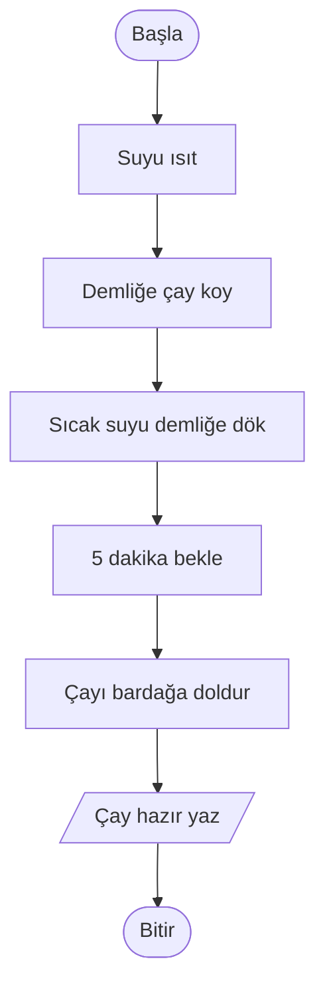
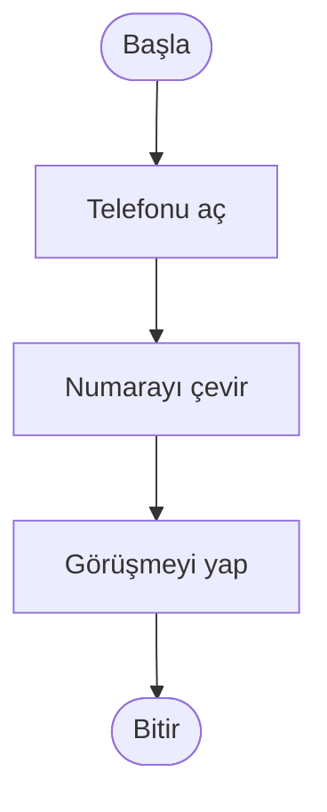
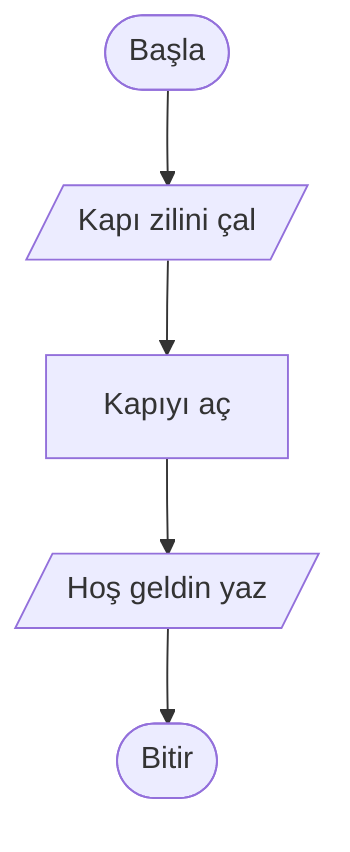

# Sözde Kod ve Akış Şeması

## 🎯 Bu Bölümde Ne Öğreneceksin?

- Sözde kodun ne olduğunu ve neden kullanıldığını açıklayacaksın.
- Türkçe sözde kodun temel kurallarını uygulayacaksın.
- Akış şeması sembollerini tanıyacaksın.
- Bir algoritmayı hem sözde kod hem akış şeması olarak ifade edeceksin.

## 💡 Neden Önemli?

Bölüm 1'de algoritmanın bir plan olduğunu gördün. Peki bu planı başkasına nasıl
aktaracaksın? Serbest bir paragrafla anlatırsan herkes farklı anlar. İşte bu
yüzden iki ortak gösterim aracı kullanırız: **sözde kod (pseudocode)** ve
**akış şeması (flowchart)**.

Bu iki araç, bu dersin ana dilidir. Çünkü bu kursta kod yazmıyoruz; ama
algoritmayı yine de kesin ve okunabilir biçimde ifade etmemiz gerekiyor. Sözde
kod, günlük dille programlama dilleri arasında bir köprüdür: insan gibi okunur,
ama adımları karışıklığa yer bırakmayacak şekilde sıralar.

> [!NOTE]
> Sözde kod gerçek bir programlama dili değildir. Onu bir bilgisayar çalıştırmaz;
> onu sen ve okuyan kişi anlar. Bu yüzden sözde kodun tek kuralı, adımların açık
> ve tutarlı olmasıdır.

## 🔗 Ön Bilgi

Bölüm 1'de algoritmanın açık, belirli ve sonlu adımlardan oluştuğunu ve her
algoritmanın bir girdisi ve bir çıktısı olduğunu öğrendin. Bu bölümde artık o
adımları belirli bir biçimde yazmayı öğreneceğiz.

## ❓ Problem

Bir arkadaşına çay demlemeyi anlatman gerekiyor. Anlatırken kendini zorluyorsun:
"Nereden başlasam, hangi sırayla söylesem?" Bir kez anlattın, arkadaşın başka
türlü yaptı; tekrar anlattın, bu sefer daha değişik yaptı.

İstediğin şey şu: Aynı tarifi okuyan iki kişi, aynı işi aynı sırayla yapsın.
Sözlü anlatım bunu sağlamıyor. Peki bir işi, karışıklığa yer bırakmadan nasıl
yazabiliriz?

## 🤔 Birlikte Düşünelim

Aynı çay tarifinin iki farklı biçimine bakalım.

**Biçim A (düz metin):**

> Çay yapmak için suyu ısıtıp demliğe biraz çay koyup üzerine döküyorsun,
> biraz bekleyip bardağa alıyorsun.

**Biçim B (adım adım):**

```text
1. Suyu ısıt.
2. Demliğe çay koy.
3. Sıcak suyu demliğe dök.
4. 5 dakika bekle.
5. Çayı bardağa doldur.
```

Bu iki biçimden hangisini takip etmek daha kolay? Neden? Cevabını yazmadan
devam etme.

Biçim A'da her şey tek bir uzun cümlede toplanmış. "Biraz çay" ne kadar? "Biraz
beklemek" ne demek? Adımların nerede başlayıp bittiği belirsiz. Biçim B'de ise
her satır tek bir iş yapar ve sırası bellidir.

Şimdi işi bir adım ileri götürelim. Biçim B'yi, adımları numaralandırmadan ve
belirli bir yazım kuralına uydurmadan yazarsak yine de bir miktar karışıklık
kalır. Elimizde bir de, adımların akışını gözle görülür hâle getiren bir araç
olsaydı harika olurdu. İşte tam bu noktada iki aracımız devreye giriyor.

## 🧭 Çözüm Fikri

Algoritmayı ifade etmek için iki araç kullanacağız:

1. **Sözde kod:** Adımları, belirli anahtar sözcükler ve düzenli bir yazımla
   kaleme alırız.
2. **Akış Şeması:** Adımları kutular ve oklarla çizerek akışın görsel hâlini
   oluştururuz.

Bu iki araç birbirinin alternatifi değildir; çoğu zaman birlikte kullanılır.
Sözde kod adımları ayrıntılı anlatır, akış şeması ise akışın genel şeklini tek
bakışta gösterir. Sözde kod okumayı, akış şeması ise görmeyi kolaylaştırır.

## 📝 Sözde Kod

Sözde kod, algoritmayı belirli bir düzen içinde yazmanın yoludur. Aşağıdaki
tablo, bu ders boyunca kullanacağımız temel anahtar sözcükleri gösterir.

| Anahtar sözcük | Ne işe yarar? |
|---|---|
| `BAŞLA` | Algoritmanın başladığı yer. |
| `BİTİR` | Algoritmanın bittiği yer. |
| `OKU` | Dışarıdan bir bilgiyi (girdiyi) al. |
| `YAZ` | Bir sonucu (çıktıyı) göster. |
| `#` | Açıklama (yorum) yaz. Bilgisayar bu satırı dikkate almaz. |

Yazım kuralları:

- `BAŞLA` en üstte, `BİTİR` en altta yer alır.
- `BAŞLA` ile `BİTİR` arasındaki adımlar soldan içeri doğru **girintilenir**
  (dört boşluk).
- Her satır tek bir iş anlatır.
- Anahtar sözcük olmayan adımlar, sade Türkçe ile yazılır.

İlk örneğimiz, hiç girdi almayan basit bir algoritma:

```pseudocode
BAŞLA
    YAZ "Merhaba"
    YAZ "Algoritma öğreniyorum"
BİTİR
```

Burada iki `YAZ` adımı sırayla çalışır: önce "Merhaba", sonra "Algoritma
öğreniyorum" çıktısı üretilir.

Şimdi çay örneğini sözde kod olarak yazalım:

```pseudocode
BAŞLA
    Suyu ısıt
    Demliğe çay koy
    Sıcak suyu demliğe dök
    5 dakika bekle
    Çayı bardağa doldur
    YAZ "Çay hazır"
BİTİR
```

Girdi alan bir örnek de yazalım:

```pseudocode
BAŞLA
    YAZ "Randevu saatini gir"
    OKU saat
    YAZ "Randevun kaydedildi"
BİTİR
```

Burada `OKU saat` adımı, kullanıcının girdiği bilgiyi alır. Alınan bilgiyi bir
ad altında saklarız; bu saklama işini (değişkenler) Bölüm 3'te ayrıntılı olarak
göreceksin.

> [!NOTE]
> Sözde kodda çift tırnak içinde yazdığımız ifadeler (`"Merhaba"` gibi) bir
> metindir. Metnin de bir veri tipi olduğunu Bölüm 3'te göreceksin.

## 🗺️ Akış Şeması

Akış şeması, algoritmayı kutular ve oklarla çizer. Her sembolün bir anlamı
vardır:

| Sembol | Adı | Ne anlatır? |
|---|---|---|
| Oval (yuvarlak köşeli) | Başlangıç / Bitiş | Algoritmanın başladığı ve bittiği yer. |
| Dikdörtgen | İşlem | Bir işin yapıldığı adım. |
| Paralel kenar | Giriş / Çıkış | Bilgi alma (`OKU`) veya gösterme (`YAZ`). |
| Eşkenar dörtgen (elmas) | Karar | Bir koşula göre yol ayrımı. |
| Ok | Akış | Adımların hangi sırayla ilerlediği. |

Bu sembollerden **elması** şimdilik yalnızca tanıyoruz. Karar yapılarını
Bölüm 4'te öğreneceğiz; o zamana kadar akış şemalarımız düz bir çizgi hâlinde
ilerleyecek.

Çay algoritmasının akış şeması şöyle görünür:



Diyagramı soldan sağa değil, yukarıdan aşağı okuyoruz: "Başla" ovalinden çıkan
ok, sırayla bütün işlemleri geziyor ve "Bitir" ovalinde sona eriyor.

Sözde kod ile akış şeması arasında birebir bir eşleşme vardır:

- `BAŞLA` ve `BİTİR` -> oval
- bir işlem satırı -> dikdörtgen
- `OKU` ve `YAZ` -> paralel kenar
- akış sırası -> oklar

## ⏱️ Elle Çalıştıralım

Şimdi az önceki akış şemasını elle çalıştıralım, yani okları takip edelim.
Varsayalım ki bu algoritma ile çay yapıyoruz.

| Sıra | Bulunduğumuz kutu | Ne oluyor? |
|---|---|---|
| 1 | Başla | Algoritma başlar. |
| 2 | Suyu ısıt | Su ısıtılır. |
| 3 | Demliğe çay koy | Demliğe çay konur. |
| 4 | Sıcak suyu dök | Su demliğe dökülür. |
| 5 | 5 dakika bekle | Beklenir. |
| 6 | Çayı bardağa doldur | Çay bardağa alınır. |
| 7 | Çay hazır yaz | "Çay hazır" çıktısı verilir. |
| 8 | Bitir | Algoritma biter. |

Şimdi de sıralamayı bilinçli olarak bozalım: suyu ısıtmayı en sona, çayı
bardağa doldurmayı da en başa koyalım. Ne olur? Su ısınmadan çay bardağa
doldurulur ve sonuç anlamsız çıkar. Akış şemasında okları takip ettiğinde bu
hatayı hemen görebilirsin; çünkü oklar, adımların gerçekte hangi sırayla
çalışacağını gösterir.

## ⚠️ Bir Şeyler Ters Giderse

**Belirti:** Sözde kodunu okuyunca adımlar mantıklı görünüyor, ama akış şemasına
çevirdiğinde bir ok yanlış yere gidiyor.

**Olası neden:** Sözde kodda bir adımın yeri yanlış yazılmış olabilir ya da iki
adım ters sırada verilmiştir.

**Ne yapmalısın?** Akış şemasını çizerken her adımı yukarıdan aşağı izle. Bir
ok, işin mantığına aykırı bir yere gidiyorsa sorun büyük olasılıkla sözde koddaki
sıralamadadır. Adımların sırasını düzeltip iki gösterimi yeniden karşılaştır.
Unutma: sözde kod ile akış şeması aynı algoritmanın iki yüzüdür; biri ile
diğeri çelişiyorsa mutlaka bir yerde hata vardır.

## ✍️ Kendin Dene

**1.** "Sabah kahvaltısı hazırlama" işini en az beş adımlık bir sözde kod
olarak yaz. `BAŞLA`, `BİTİR` ve girintiyi kullan.

**2.** Aşağıdaki sözde kodu bir akış şemasına dönüştür (Mermaid ile).

```pseudocode
BAŞLA
    YAZ "Kapı zilini çal"
    Kapıyı aç
    YAZ "Hoş geldin"
BİTİR
```

**3.** Aşağıdaki akış şemasındaki işlemleri sırayla yaz.



<details>
<summary>İpucu</summary>

1. Her adım tek bir iş yapsın; "kahvaltı hazırla" gibi genel bir adım yazma.
2. Sözde koddaki her `YAZ` satırı paralel kenar, her işlem satırı dikdörtgen,
   `BAŞLA` ve `BİTİR` oval olur.
3. Okların yönünü takip et; kutuların yazdığı işi sırayla listele.

</details>

<details>
<summary>Çözümleri göster</summary>

1. Örnek bir cevap:

```pseudocode
BAŞLA
    Bardağı al
    Sütü bardağa koy
    Ekmeği dilimle
    Peyniri tabağa koy
    YAZ "Kahvaltı hazır"
BİTİR
```

Adımların sayısı ve içeriği değişebilir; önemli olan her satırın tek bir iş
yapması ve sıranın mantıklı olmasıdır.

2. Çözüm:



3. Sıra: (1) Telefonu aç, (2) Numarayı çevir, (3) Görüşmeyi yap.

</details>

## 🎓 Öğrendiklerini Kontrol Et

**1.** Sözde kod nedir? Onu neden kullanıyoruz?

**2.** `BAŞLA` ve `BİTİR` sözde kodda ne işe yarar?

**3.** Aşağıdaki sembolleri işleriyle eşleştir: oval, dikdörtgen, paralel kenar.

**4.** `OKU` ile `YAZ` arasındaki fark nedir?

<details>
<summary>Cevapları göster</summary>

1. Sözde kod, bir algoritmayı belirli anahtar sözcükler ve düzenli bir yazımla
ifade etme yoludur. Adımları karışıklığa yer bırakmadan anlatmak ve başkalarıyla
paylaşmak için kullanılır.

2. `BAŞLA`, algoritmanın başladığını; `BİTİR`, algoritmanın bittiğini gösterir.
Böylece adımların nerede başlayıp nerede sona erdiği bellidir.

3. Oval: başlangıç/bitiş. Dikdörtgen: işlem. Paralel kenar: giriş/çıkış
(`OKU`/`YAZ`).

4. `OKU`, dışarıdan bilgi alır (girdi). `YAZ`, bir sonucu gösterir (çıktı).

</details>

## 🚀 Bağımsız Çalışma

Bölüm 1'de bağımsız çalışmada yazdığın günlük hayat algoritmasını eline al. Onu
önce sözde kod olarak, sonra akış şeması olarak ifade et. Ardından bir adımı
çıkar ve akış şemasını yeniden çiz. Çıkardığın adımın akışı nasıl bozduğunu
gözlemle; hangi adımın gerçekten gerekli olduğunu bu şekilde daha iyi
anlayacaksın.

## 📖 Daha Fazlasını Öğrenmek

- Akış şeması sembolleri dünya genelinde ortak bir standartla belirlenmiştir
  (ISO 5807). Farklı kaynaklarda aynı sembolleri göreceksin.
- Türkçe Vikipedi'nin "Akış şeması" ve "Sözde kod" maddeleri kavramların
  tanımına kısa bir bakış sunar.
- Çevrendeki kılavuzlarda küçük akış şemaları ara; örneğin bir ürünün kurulum
  kılavuzunda ya da bir sorun giderme adımında bu sembollerle karşılaşabilirsin.

## 📌 Kısa Özet

- Algoritmayı iki temel araçla ifade ederiz: sözde kod ve akış şeması.
- Sözde kodda temel anahtar sözcükler `BAŞLA`, `BİTİR`, `OKU`, `YAZ` ve yorum
  için `#` işaretidir.
- Sözde kodda adımlar girintilenir ve her satır tek bir iş yapar.
- Akış şemasında başlangıç/bitiş oval, işlem dikdörtgen, giriş/çıkış paralel
  kenar, akış oklarla gösterilir.
- Karar (elmas) sembolünü Bölüm 4'te kullanacağız.
- Sözde kod ile akış şeması aynı algoritmanın iki farklı gösterimidir.
- Bir sonraki bölümde, algoritmalarda değerleri nasıl saklayacağımızı
  (değişkenler, veri tipleri ve işlemler) öğreneceksin.

---
[Geri: Algoritma Nedir?](01-Algorithm-Basics.md) | [İleri: Değişkenler, Veri Tipleri ve İşlemler](03-Variables-Types-Operations.md)
