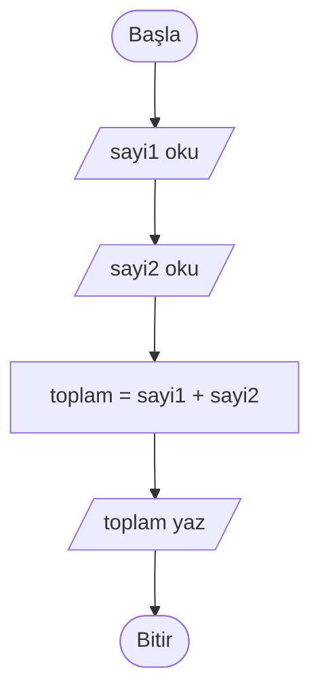
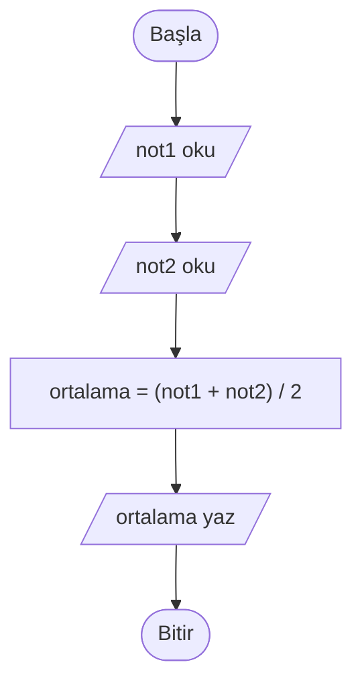
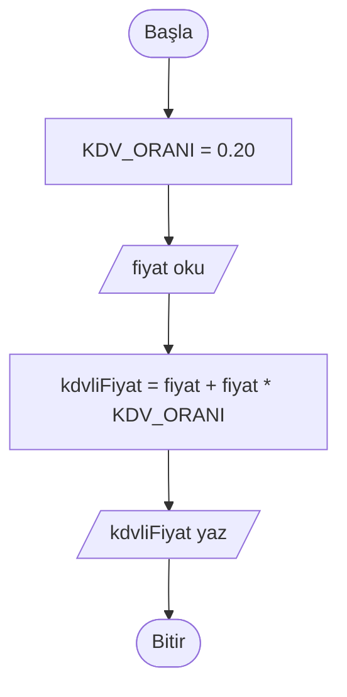

# Değişkenler, Veri Tipleri ve İşlemler

## 🎯 Bu Bölümde Ne Öğreneceksin?

- Değişken ve sabit kavramlarını açıklayacaksın.
- Temel veri tiplerini ayırt edeceksin.
- Atama işlemini ve okunuşunu öğreneceksin.
- Aritmetik, karşılaştırma ve mantıksal işlemleri uygulayacaksın.
- İşlem sırasını ve parantez kullanımını yorumlayacaksın.

## 💡 Neden Önemli?

Bölüm 1'de bir algoritmayı elle çalıştırırken "aklında tuttuğun sayı" diye bir
şeyden söz etmiştik. Bir algoritmanın, üzerinde çalıştığı bilgileri bir yerde
tutması gerekir. İşte algoritmaların belleği değişkenlerdir.

Değişkenler olmadan bir algoritma, elindeki sayıları karşılaştıramaz, toplamını
tutamaz, sonucu bir sonraki adıma taşıyamaz. Kısacası neredeyse her algoritma,
saklanacak bir değere ihtiyaç duyar. Bu bölüm, algoritmaların en temel yapı
taşını öğretir.

## 🔗 Ön Bilgi

Bölüm 1'de algoritmanın girdi, adımlar ve çıktıdan oluştuğunu; Bölüm 2'de bu
adımları sözde kodla nasıl yazacağımızı öğrendin. Şimdi o adımların içinde
değerleri nasıl saklayıp işleyeceğimizi göreceğiz.

## ❓ Problem

Kullanıcıdan iki sayı alıp bu sayıların toplamını yazan bir algoritma yazman
isteniyor. İlk denemende şöyle bir şey çıkıyor:

```pseudocode
BAŞLA
    OKU sayi1
    OKU sayi2
    YAZ toplam
BİTİR
```

Bir sorun var: bu algoritma "toplam" diye bir şeyi nereden biliyor? Kullanıcının
girdiği iki sayıyı bir yerde tutmamız ve toplamı hesaplayıp saklamamız gerekmez
mi? Peki bu değerleri nerede tutacağız?

## 🤔 Birlikte Düşünelim

Mutfakta üzerlerinde etiket olan boş kavanozlar düşün. Her kavanozun bir adı var:
"şeker", "tuz", "un". İçine ne koyarsan o kavanozda o kalır; sonra kavanozu
açıp içindekine bakabilir ya da içindekini değiştirebilirsin.

Bir algoritma da tıpkı bunun gibi çalışır. Değerleri koyacağı, adı olan yerler
ister. Bir kavanoza "toplam" etiketi yapıştırıp içine iki sayının toplamını
koyabiliriz. Sonra algoritmanın başka bir yerinde o kavanozu açıp içindeki
toplamı yazdırabiliriz.

Şimdi kendine sor: Az önceki bozuk algoritmada eksik olan şey tam olarak neydi?
Cevabı yazmadan devam etme.

Eksik olan şey, hesaplanan sonucun konacağı yerdi. `YAZ toplam` satırı, "toplam"
adında bir kavanoz olduğunu varsayıyor; ama bu kavanoz hiç oluşturulmamış ve
içine bir değer konmamış. Birazdan bu eksikliği gidereceğiz.

## 🧭 Çözüm Fikri

**Değişken (variable):** İçine bir değer koyduğumuz, adı olan ve içindeki değer
zamanla değişebilen yerdir. Az önceki kavanoz benzetmesindeki kavanozun ta
kendisidir.

**Sabit (constant):** Değeri bir kez belirlenen ve artık değişmeyen yerdir. Örneğin
bir dairenin alanını hesaplarken kullanılan pi sayısı, ya da bir ülkedeki katma
değer vergisi oranı, program boyunca değişmez. Sabitler, değerin yanlışlıkla
değiştirilmesini engeller.

Değişken adlarını seçerken şu basit kurallara dikkat et:

- Anlamlı bir ad seç; `a`, `x` gibi isimler yerine `toplam`, `ortalama` gibi
  adlar kullan.
- Ad küçük harfle başlasın; kelimeleri birleştir, boşluk bırakma (örneğin
  `ogrenciNotu`, `kisaKenar`).
- Ad, ne sakladığını anlatsın: `toplam` iyidir, `t` yetersizdir.

Bozuk algoritmadaki eksik satır şuydu: hesaplanan sonucu bir değişkene atmak.

```pseudocode
toplam = sayi1 + sayi2
```

Bu satır, sağdaki hesaplanan değeri soldaki `toplam` değişkenine koyar. Artık
`YAZ toplam` satırı anlamlıdır. Bu satırın tam çalışan hâlini birazdan Sözde
Kod bölümünde bir arada göreceğiz.

### Veri Tipleri

Bir değişkenin içine her türlü bilgiyi koyamayız. Sakladığımız bilginin bir
**veri tipi (data type)** vardır. Bu derste en çok kullanacağımız dört tip:

| Veri tipi | Örnek değerler | Ne saklar? |
|---|---|---|
| Tam sayı | `5`, `-12`, `0` | Virgülsüz sayılar |
| Ondalık sayı | `3.14`, `-0.5`, `2.0` | Virgüllü (küsurlu) sayılar |
| Metin | `"Merhaba"`, `"12A"` | Harf, sözcük, cümle |
| Mantıksal | `doğru`, `yanlış` | İki seçenekli durumlar (evet/hayır) |

Veri tipi neden önemli? Çünkü bir metinle bir sayıyı anlamlı biçimde toplayamazsın.
`"elma" + 3` işleminin matematiksel bir karşılığı yoktur. Ayrıca `"12"` (metin)
ile `12` (sayı) farklı şeylerdir: biri yazıdır, diğeri üzerinde işlem
yapabileceğin bir sayıdır.

### Atama İşlemi

Sözde kodda bir değişkene değer vermek için `=` işaretini kullanırız:

```pseudocode
yas = 20
isim = "Ayşe"
```

Bu satırlar "yirmiyi `yas` değişkenine ata" ve "Ayşe metnini `isim` değişkenine
ata" diye okunur. Buradaki `=` işareti "eşittir" anlamına gelmez; "soldaki
değişkene, sağdaki değeri koy" demektir.

> [!IMPORTANT]
> Atama ile eşitlik kontrolü iki farklı işarettir. `yas = 20` bir **atamadır**:
> 20 değerini `yas` değişkenine koyar. `yas == 20` ise bir **karşılaştırmadır**:
> `yas` değişkeninin değeri 20'ye eşit mi diye sorar ve `doğru` ya da `yanlış`
> sonucunu verir. İkisini karıştırmamak çok önemlidir.

### Aritmetik İşlemler

| İşlem | İşaret | Örnek | Sonuç |
|---|---|---|---|
| Toplama | `+` | `7 + 3` | `10` |
| Çıkarma | `-` | `7 - 3` | `4` |
| Çarpma | `*` | `7 * 3` | `21` |
| Bölme | `/` | `7 / 2` | `3.5` |
| Kalan (mod) | `mod` | `7 mod 3` | `1` |

`mod` işlemi, bölmeden kalanı verir. `7 mod 3` işleminin sonucu 1'dir; çünkü 7
sayısının içinde 3 iki kez vardır (6 eder) ve geriye 1 kalır. `mod` işlemi
bir sayının çift mi tek mi olduğunu anlamak için çok kullanışlıdır: bir sayının
`2 mod`'u 0 ise sayı çifttir.

### Karşılaştırma İşlemleri

Karşılaştırma işlemleri iki değeri kıyaslar ve sonuç olarak mantıksal bir değer
(`doğru` ya da `yanlış`) üretir.

| İşlem | İşaret | Örnek | Sonuç |
|---|---|---|---|
| Eşit mi? | `==` | `5 == 5` | `doğru` |
| Eşit değil mi? | `!=` | `5 != 3` | `doğru` |
| Küçük mü? | `<` | `3 < 5` | `doğru` |
| Büyük mü? | `>` | `3 > 5` | `yanlış` |
| Küçük veya eşit mi? | `<=` | `4 <= 4` | `doğru` |
| Büyük veya eşit mi? | `>=` | `2 >= 5` | `yanlış` |

Bu işlemler şimdilik tek başına pek işe yaramaz gibi görünebilir; ama Bölüm 4'te
göreceğin karar yapılarının temelini oluştururlar.

### Mantıksal İşlemler

Bazen birden çok koşulu birleştirmek isteriz. Bunun için üç bağlaç kullanırız:

- `VE`: Her iki taraf da doğruysa sonuç doğrudur.
- `VEYA`: Taraflardan en az biri doğruysa sonuç doğrudur.
- `DEĞİL`: Doğruyu yanlışa, yanlışı doğruya çevirir.

| İfade | Sonuç | Neden? |
|---|---|---|
| `(5 > 3) VE (2 < 4)` | `doğru` | İki taraf da doğru. |
| `(5 > 3) VE (2 > 4)` | `yanlış` | İkinci taraf yanlış. |
| `(5 > 3) VEYA (2 > 4)` | `doğru` | Birinci taraf doğru. |
| `DEĞİL (5 > 3)` | `yanlış` | Doğrunun tersi. |

### İşlem Sırası

Birden çok işlem bir arada olduğunda hangi işlemin önce yapılacağı bellidir:

1. Parantez içindeki işlemler.
2. Çarpma, bölme ve `mod` (soldan sağa).
3. Toplama ve çıkarma (soldan sağa).

Örneğin `2 + 3 * 4` işlemi 14 eder; çünkü önce `3 * 4` (12) hesaplanır, sonra
2 eklenir. `(2 + 3) * 4` ise 20 eder; çünkü parantez önce gelir. İşlem sırasını
karıştırmamak için, niyetini netleştirmek adına parantez kullanmaktan çekinme.

## 📝 Sözde Kod

Artık öğrendiklerimizi bir arada kullanabiliriz. İlk örnek, iki sayının
toplamını bulan algoritmadır:

```pseudocode
BAŞLA
    OKU sayi1
    OKU sayi2
    toplam = sayi1 + sayi2
    YAZ toplam
BİTİR
```

İkinci örnek, kullanıcıdan iki ders notu alıp ortalamasını hesaplar:

```pseudocode
BAŞLA
    # Kullanıcıdan iki not al
    OKU not1
    OKU not2

    # Ortalamayı hesapla
    ortalama = (not1 + not2) / 2

    # Sonucu yaz
    YAZ ortalama
BİTİR
```

Üçüncü örnek, bir ürün fiyatına katma değer vergisi ekler. `KDV_ORANI`
değişmemesi gereken bir sabittir:

```pseudocode
BAŞLA
    KDV_ORANI = 0.20
    OKU fiyat
    kdvliFiyat = fiyat + fiyat * KDV_ORANI
    YAZ kdvliFiyat
BİTİR
```

## 🗺️ Akış Şeması

Üç örneğin akış şemaları sırasıyla aşağıdadır. Giriş ve çıkış adımları paralel
kenar, işlem adımları dikdörtgen, başlangıç ve bitiş oval biçimindedir.

Toplam algoritmasının akış şeması:



Ortalama algoritmasının akış şeması:



KDV algoritmasının akış şeması:



Her şemada, sözde koddaki her satıra karşılık gelen bir kutu vardır. Girdiyi
alan ve sonucu gösteren kutular paralel kenar biçimindedir.

## ⏱️ Elle Çalıştıralım

Ortalama algoritmasını (70 ve 80) notlarıyla elle çalıştıralım. Değişkenlerin
adım adım aldığı değerleri izleyelim.

| Adım | Ne oluyor? | not1 | not2 | ortalama |
|---|---|---|---|---|
| OKU not1 | İlk not alınır. | 70 | - | - |
| OKU not2 | İkinci not alınır. | 70 | 80 | - |
| ortalama = | (70 + 80) / 2 hesaplanır. | 70 | 80 | 75 |
| YAZ ortalama | 75 yazılır. | 70 | 80 | 75 |

Şimdi de birkaç ifadenin sonucunu elle hesaplayalım:

| İfade | Ara adım | Sonuç |
|---|---|---|
| `10 - 2 * 3` | Önce `2 * 3 = 6`, sonra `10 - 6` | `4` |
| `(10 - 2) * 3` | Önce `10 - 2 = 8`, sonra `8 * 3` | `24` |
| `20 mod 6` | 20 içinde 6 üç kez (18), kalan 2 | `2` |
| `9 / 2` | Bölme ondalıklı sonuç verir | `4.5` |
| `(7 > 5) VE (3 != 3)` | Birinci doğru, ikinci yanlış | `yanlış` |

Bu tabloyu kendi kendine de tekrar edebilirsin; her satırda ara adımı yazmak,
işlem sırasını kavramanın en iyi yoludur.

## ⚠️ Bir Şeyler Ters Giderse

**Belirti 1:** Algoritma çalışmıyor ve hata "atanan değer yanlış yerde" gibi
görünüyor.

**Olası neden:** Atama sırasında değer, yanlış tarafa yazılmıştır. Şu satıra bak:

```pseudocode
5 = yas
```

Bu satır yanlıştır. Çünkü atama işleminde değer her zaman soldaki değişkene
gider. Doğrusu `yas = 5` olmalıdır. `5 = yas` yazmak, beş sayısına bir değer
atamaya çalışmak gibi anlamsızdır.

**Belirti 2:** İki farklı türdeki değer işleme sokulduğunda sonuç anlamsız
çıkıyor.

**Olası neden:** Veri tipleri uyuşmuyordur. Örneğin:

```pseudocode
sonuc = "elma" + 3
```

Bir metinle bir sayıyı toplamak anlamlı değildir. Böyle bir satır gördüğünde,
o değerlerden birinin tipini gözden geçir: belki de sayı olması gereken yerine
metin yazılmıştır.

**Belirti 3:** Bir koşul yazdığını düşünüyorsun ama algoritma koşulu hiç
kontrol etmiyor gibi davranıyor.

**Olası neden:** Atama (`=`) ile eşitlik karşılaştırması (`==`) karıştırılmıştır.
Bir değerin başka bir değere eşit olup olmadığını sormak istiyorsan `==`
kullanmalısın; `=` yalnızca atamak içindir.

## ✍️ Kendin Dene

**1.** Aşağıdaki adlardan hangileri geçerli ve anlamlı birer değişken adıdır?
`toplam`, `1sayi`, `ogrenciNotu`, `öğrenci notu`, `x`

**2.** Bir dikdörtgenin alanını hesaplayan bir sözde kod yaz. Kısa kenar ve uzun
kenar kullanıcıdan alınsın; sonuç `alan` değişkeninde saklansın ve yazdırılsın.

**3.** Aşağıdaki ifadelerin sonucunu hesapla:
`8 + 2 * 5`, `(8 + 2) * 5`, `17 mod 4`, `10 >= 10`

<details>
<summary>İpucu</summary>

1. Bir ad küçük harfle başlamalı, boşluk içermemeli ve ne sakladığını
   anlatmalıdır.
2. Girdileri `OKU` ile al; alanı `kisaKenar * uzunKenar` ile hesapla; sonucu
   `YAZ` ile göster.
3. İşlem sırasını hatırla: parantez, sonra çarpma/bölme/mod, sonra toplama/çıkarma.

</details>

<details>
<summary>Çözümleri göster</summary>

1. `toplam` geçerlidir ve anlamlıdır. `1sayi` geçersizdir; ad rakamla
   başlayamaz. `ogrenciNotu` geçerlidir ve anlamlıdır. `öğrenci notu` geçersizdir;
   boşluk içerir. `x` geçerlidir ama anlamsızdır; ne sakladığını anlatmaz.

2. Örnek çözüm:

```pseudocode
BAŞLA
    OKU kisaKenar
    OKU uzunKenar
    alan = kisaKenar * uzunKenar
    YAZ alan
BİTİR
```

3. `8 + 2 * 5` -> önce `2 * 5 = 10`, sonra `8 + 10` = `18`. `(8 + 2) * 5` ->
   önce `10`, sonra `10 * 5` = `50`. `17 mod 4` = 4 kere 4 (16), kalan `1`.
   `10 >= 10` -> `doğru`.

</details>

## 🎓 Öğrendiklerini Kontrol Et

**1.** Değişken ile sabit arasındaki fark nedir?

**2.** Neden veri tipi önemlidir? Bir örnekle açıkla.

**3.** `=` işareti ile `==` işareti arasındaki fark nedir?

**4.** `3 + 4 * 2` ifadesinin sonucu kaçtır? Neden?

<details>
<summary>Cevapları göster</summary>

1. Değişkenin değeri çalışma sırasında değişebilir; sabitin değeri bir kez
belirlenir ve değişmez. Sabitler, değerin yanlışlıkla değiştirilmesini önler.

2. Çünkü farklı tiplerle yapılabilecek işlemler farklıdır. Örneğin `"12"`
metniyle `12` sayısı farklıdır; bir metinle bir sayıyı toplamak anlamlı bir
sonuç vermez.

3. `=` atama işaretidir ve sağdaki değeri soldaki değişkene koyar (`yas = 20`).
`==` ise karşılaştırma işaretidir ve iki değerin eşit olup olmadığını kontrol
eder (`yas == 20` -> `doğru` ya da `yanlış`).

4. Sonuç 11'dir. Önce `4 * 2 = 8` hesaplanır, sonra `3 + 8 = 11` olur. Çarpma
toplamadan önce gelir.

</details>

## 🚀 Bağımsız Çalışma

Bir market alışverişi düşün. Kullanıcı üç ürünün fiyatını girsin. Algoritma,
ürünlerin toplamını ve ortalamasını hesaplasın; sonra toplam tutara sabit bir
`KDV_ORANI` uygulayıp ödenecek tutarı yazsın.

Değişkenlerini önce kâğıt üzerinde listele (adları ve ne sakladıkları). Sonra
sözde kodu yaz ve akış şemasını çiz. En sonunda bir örnek fiyat üçlüsü seçip
algoritmayı elle çalıştır ve bulduğun sonucu bir hesap makinesiyle karşılaştır.
Aradaki fark, nerede hata yaptığını gösterecektir.

## 📖 Daha Fazlasını Öğrenmek

- Türkçe Vikipedi'nin "Değişken (programlama)" ve "Veri tipi" maddeleri bu
  kavramların tanımına kısa bir bakış sunar.
- `mod` işleminin günlük hayatta pek çok karşılığı vardır: saatin 12'den sonra
  başa dönmesi, bir sayının çift mi tek mi olduğunu anlamak, bir sıradaki kişiyi
  belirlemek. Bu örnekleri düşünerek `mod`'u pekiştirebilirsin.

## 📌 Kısa Özet

- Değişken, adı olan ve değeri değişebilen bir saklama yeridir; sabit ise
  değişmeyen bir değerdir.
- Temel veri tipleri: tam sayı, ondalık sayı, metin ve mantıksal.
- Atama `=` işaretiyle yapılır ve sağdaki değeri soldaki değişkene koyar.
- Eşitlik karşılaştırması `==`, eşit değillik `!=`, diğer karşılaştırmalar `<`,
  `>`, `<=`, `>=` işaretleriyle yapılır.
- Aritmetik işlemler: `+`, `-`, `*`, `/`, `mod`.
- Mantıksal bağlaçlar `VE`, `VEYA` ve `DEĞİL`'dir.
- İşlem sırası: parantez, sonra çarpma/bölme/mod, sonra toplama/çıkarma.
- Bir sonraki bölümde, bu karşılaştırmaları kullanarak algoritmanın farklı
  durumlarda farklı davranmasını sağlayan karar yapılarını öğreneceksin.

---
[Geri: Sözde Kod ve Akış Şeması](02-Pseudocode-And-Flowchart.md) | [İleri: Karar Yapıları](04-Decision-Structures.md)
