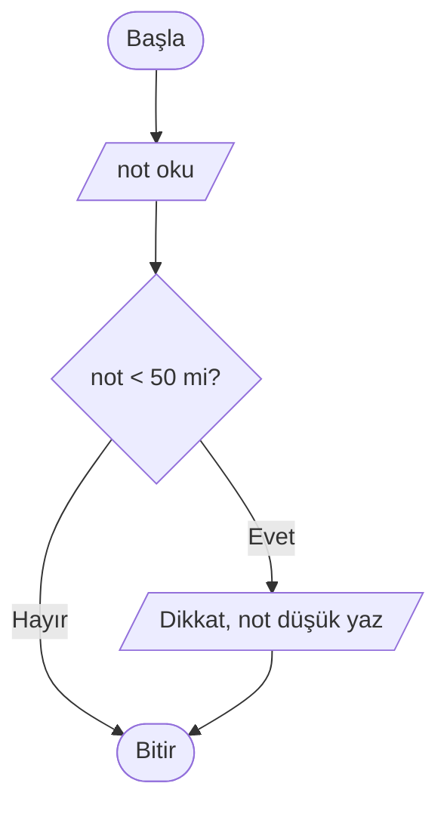
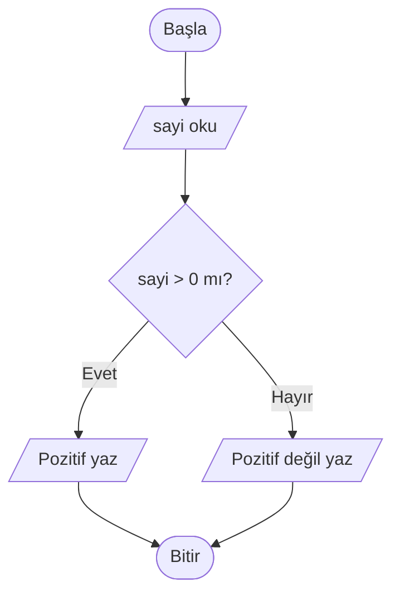
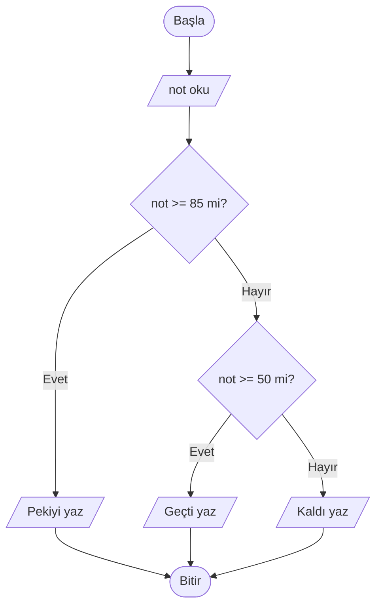
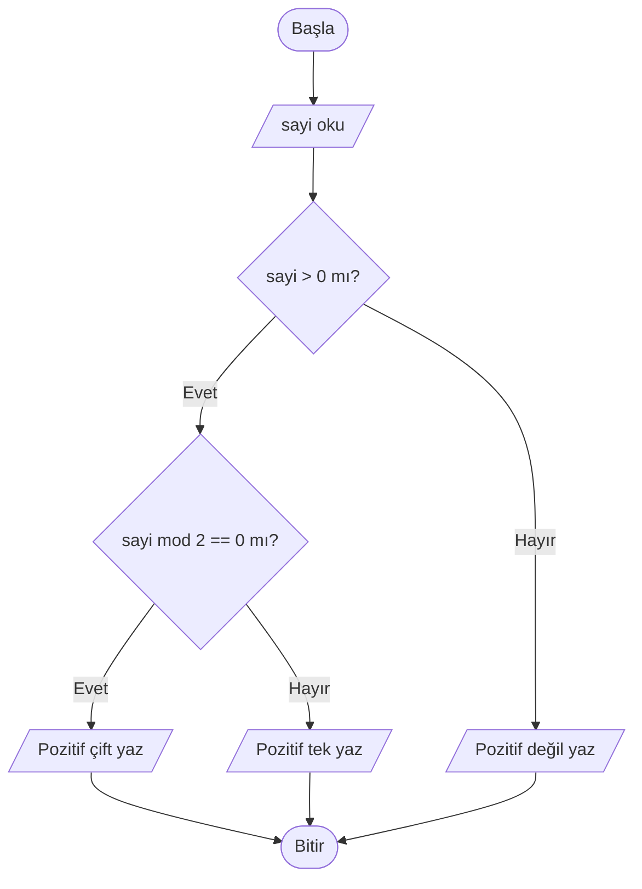
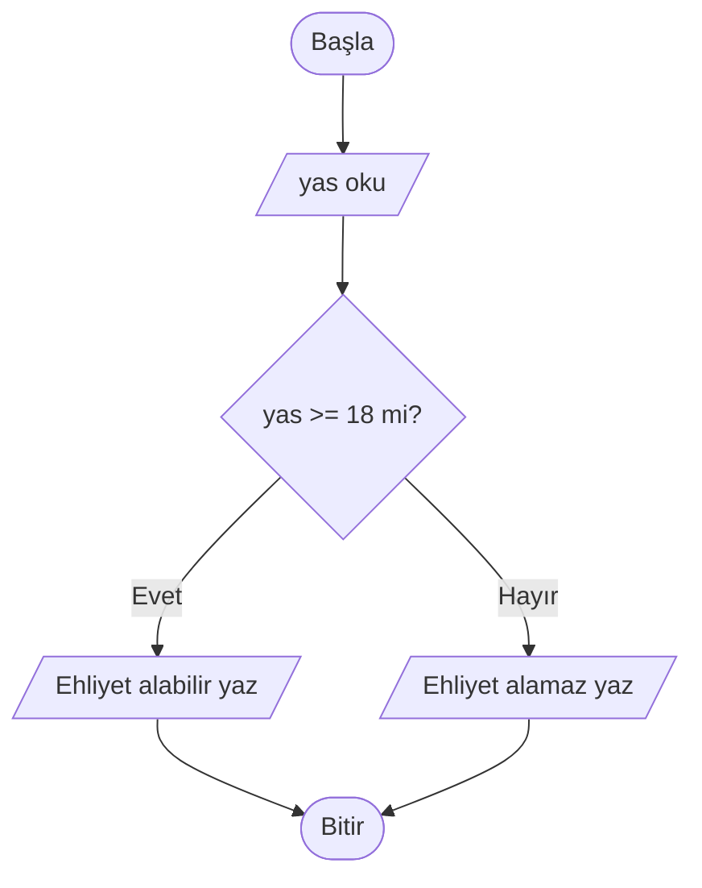

# Karar Yapıları

## 🎯 Bu Bölümde Ne Öğreneceksin?

- Koşul kavramını ve mantıksal sonuçları kullanmayı öğreneceksin.
- `EĞER ... İSE` yapısıyla tek yönlü karar kuracaksın.
- `EĞER ... DEĞİLSE` yapısıyla iki yönlü karar kuracaksın.
- `DEĞİLSE EĞER` ile çoklu karar vereceksin.
- İç içe karar yapılarını kuracak ve akış şemasında göstereceksin.

## 💡 Neden Önemli?

Şimdiye kadar yazdığımız algoritmalar hep aynı yolu izliyordu: birinci adım,
ikinci adım, üçüncü adım... Ama gerçek hayat böyle değildir. Sabah "hava
yağmurluysa şemsiye alırım" deriz. Notun "50 veya üzeriyse geçtim" deriz. Yani
duruma göre farklı davranırız.

Bölüm 3'te karşılaştırma işlemlerinin `doğru` ya da `yanlış` sonucu ürettiğini
görmüştün. Şimdi o sonucu kullanıp algoritmanın farklı yollara sapmasını
sağlayacağız. Karar yapıları olmadan algoritmalar yalnızca düz bir çizgide
ilerler; onlarla birlikte akıllı davranmaya başlarlar.

## 🔗 Ön Bilgi

Bölüm 3'te karşılaştırma işlemlerini (`>`, `<`, `==`, `>=` vb.) ve `VE`, `VEYA`,
`DEĞİL` bağlaçlarını öğrendin. Karar yapılarının koşulu tam olarak bu
işlemlerden doğar.

## ❓ Problem

Kullanıcıdan bir sayı alıp bu sayının pozitif olup olmadığını yazacak bir
algoritma istiyoruz. Sayı pozitifse "Pozitif", değilse "Pozitif değil"
yazmalı.

Bölüm 3'te öğrendiklerimizle bunu yazmayı deneyelim:

```pseudocode
BAŞLA
    OKU sayi
    YAZ "Pozitif"
    YAZ "Pozitif değil"
BİTİR
```

Bu algoritma her iki mesajı da yazar; çünkü hangi mesajın ne zaman yazılacağını
söyleyen bir karar yok. Peki algoritmaya "duruma göre seç" demeyi nasıl
öğretiriz?

## 🤔 Birlikte Düşünelim

Günlük hayattan şu kuralı düşün: "Dışarı çıkmadan önce pencereye bak. Hava
yağmurluysa şemsiyeni al." Burada bir **koşul** (hava yağmurlu mu?) ve bu koşula
bağlı bir **eylem** (şemsiyeyi al) vardır. Hava yağmurlu değilse hiçbir şey
yapmazsın.

Şimdi kendine sor: Bir algoritmanın, koşul doğru olduğunda bir işi yapıp yanlış
olduğunda yapmaması nasıl sağlanır? Peki koşul yanlış olduğunda başka bir iş
yapmasını istersek? Cevabını yazmadan devam etme.

İhtiyacımız olan şey, algoritmaya "iki yoldan birini seç" diyebilmektir. İşte
bunu karar yapıları sağlar.

## 🧭 Çözüm Fikri

**Karar yapısı (decision structure),** bir koşulun `doğru` ya da `yanlış`
olmasına göre algoritmanın farklı adımları çalıştırmasını sağlar.

Koşul, Bölüm 3'te öğrendiğin karşılaştırma işlemlerinden biridir. Örneğin
`sayi > 0` ifadesi ya `doğru` ya da `yanlış` sonucunu verir; karar yapısı da bu
sonuca bakar.

Üç biçim kullanacağız:

1. **Tek yönlü karar:** Koşul doğruysa bir iş yapılır; yanlışsa hiçbir şey
   yapılmaz.
2. **İki yönlü karar:** Koşul doğruysa bir iş, yanlışsa başka bir iş yapılır.
3. **Çoklu karar:** Birden çok koşul sırayla denenir; ilk doğru olanın işi
   yapılır.

## 📝 Sözde Kod

Karar yapısının genel yazımı şöyledir:

```pseudocode
EĞER koşul İSE
    ...
DEĞİLSE
    ...
EĞER SONU
```

`EĞER SONU` satırı, karar bloğunun bittiğini gösterir. Bloğun içindeki adımlar
bir kademe daha girintilenir.

**Tek yönlü karar.** Bir notun geçme notu olan 50'den küçük olup olmadığına
bakalım; küçükse uyarı yazalım:

```pseudocode
BAŞLA
    OKU not
    EĞER not < 50 İSE
        YAZ "Dikkat, not düşük"
    EĞER SONU
BİTİR
```

**İki yönlü karar.** Az önceki problemimizi artık doğru biçimde yazabiliriz:

```pseudocode
BAŞLA
    OKU sayi
    EĞER sayi > 0 İSE
        YAZ "Pozitif"
    DEĞİLSE
        YAZ "Pozitif değil"
    EĞER SONU
BİTİR
```

Bu algoritma, `sayi > 0` koşulu doğruysa "Pozitif", yanlışsa "Pozitif değil"
yazar.

**Çoklu karar.** Bir notu dört kademeye ayıralım:

```pseudocode
BAŞLA
    OKU not
    EĞER not >= 85 İSE
        YAZ "Pekiyi"
    DEĞİLSE EĞER not >= 50 İSE
        YAZ "Geçti"
    DEĞİLSE
        YAZ "Kaldı"
    EĞER SONU
BİTİR
```

Burada koşullar yukarıdan aşağıya sırayla denenir. İlk doğru olan koşulun
bloğu çalışır ve diğerleri atlanır. Bu yüzden sıralama önemlidir: `not` 90 ise
ilk koşul doğrudur ve "Pekiyi" yazılır.

**İç içe karar.** Bir karar yapısının içine başka bir karar yapısı koyabiliriz.
Bir sayının pozitif çift mi yoksa pozitif tek mi olduğunu bulalım:

```pseudocode
BAŞLA
    OKU sayi
    EĞER sayi > 0 İSE
        EĞER sayi mod 2 == 0 İSE
            YAZ "Pozitif çift"
        DEĞİLSE
            YAZ "Pozitif tek"
        EĞER SONU
    DEĞİLSE
        YAZ "Pozitif değil"
    EĞER SONU
BİTİR
```

## 🗺️ Akış Şeması

Karar yapısı, akış şemasında **elmas** sembolüyle gösterilir. Elmasın içine
koşul yazılır; elmastan çıkan iki ok, koşulun sonucunu gösterir: "Evet" ve
"Hayır". Dört karar biçiminin akış şeması şöyledir.

**Tek yönlü karar:**



Koşul yanlışsa hiçbir işlem yapılmaz; akış doğrudan "Bitir" ovaline gider.

**İki yönlü karar:**



Okları izlediğinde iki ayrı yol görürsün; algoritma bunlardan yalnızca birini
seçer. "Evet" ve "Hayır" yolları, "Bitir" ovalinde tekrar birleşir.

**Çoklu karar:**



İlk elmasın "Hayır" çıkışı ikinci bir elmasa bağlanır; koşullar sırayla denenir
ve ilk doğru olan yol izlenir.

**İç içe karar:**



Bir elmasın "Evet" dalının içine ikinci bir elmas yerleştirilmiştir. İçteki
karar yalnızca dıştaki koşul doğru olduğunda çalışır.

## ⏱️ Elle Çalıştıralım

İki yönlü karar algoritmasını iki farklı girdi ile elle çalıştıralım.

**Girdi: 5**

| Adım | Ne oluyor? | Koşul sonucu |
|---|---|---|
| OKU sayi | sayi = 5 olur. | - |
| Koşul | 5 > 0 mudur? | doğru |
| Evet yolu | "Pozitif" yazılır. | - |
| Bitir | Algoritma biter. | - |

**Girdi: -3**

| Adım | Ne oluyor? | Koşul sonucu |
|---|---|---|
| OKU sayi | sayi = -3 olur. | - |
| Koşul | -3 > 0 mudur? | yanlış |
| Hayır yolu | "Pozitif değil" yazılır. | - |
| Bitir | Algoritma biter. | - |

İyi bir alışkanlık, karar yapısını çalıştırırken koşulun sınırında ne
olacağını sormaktır. Bizim örneğimizde: `sayi` tam olarak 0 olursa ne olur?
Koşul `sayi > 0` olduğu için 0 durumunda sonuç `yanlış` çıkar ve "Pozitif değil"
yazılır. Eğer amacın 0'ı da pozitif saymak olsaydı `sayi >= 0` yazman gerekirdi.
Bu küçük fark, algoritmanın doğruluğunu doğrudan etkiler.

## ⚠️ Bir Şeyler Ters Giderse

**Belirti:** Sözde kodun bir bloğu diğerini de etkiliyor ya da `EĞER SONU`
beklenmedik yerde bitiyor.

**Olası neden:** `EĞER SONU` satırı unutulmuş ya da girinti yanlış yapılmış
olabilir. Girinti, hangi adımların hangi karar bloğuna ait olduğunu gösterir.
Girintiyi bozarsan blok sınırları kaybolur ve algoritma yanlış çalışır.

**Ne yapmalısın?** Her `EĞER` satırının bir `EĞER SONU` ile kapandığını kontrol
et. İç içe kararlarda her `EĞER` için ayrı bir `EĞER SONU` gerektiğini unutma.
Bir bloğun nerede başlayıp bittiğini görmek için girintileri merdiven gibi
düşün.

## ✍️ Kendin Dene

**1.** Kullanıcıdan bir sayı alıp bu sayının tek mi çift mi olduğunu yazan bir
sözde kod yaz. (Hatırlatma: `mod` işlemi işine yarayacak.)

**2.** Kullanıcıdan üç sayı alıp en büyüğünü bulan bir algoritma yaz.

**3.** Aşağıdaki akış şemasını sözde koda dönüştür.



<details>
<summary>İpucu</summary>

1. Bir sayının çift olması, `2 mod`'unun 0 olması demektir.
2. Önce birinci ile ikinciyi karşılaştır; sonra bulduğun büyüğü üçüncü ile
   karşılaştır.
3. Akış şemasındaki elmas bir `EĞER ... İSE ... DEĞİLSE` yapısına karşılık gelir.

</details>

<details>
<summary>Çözümleri göster</summary>

1. Örnek çözüm:

```pseudocode
BAŞLA
    OKU sayi
    EĞER sayi mod 2 == 0 İSE
        YAZ "Çift"
    DEĞİLSE
        YAZ "Tek"
    EĞER SONU
BİTİR
```

2. Örnek çözüm:

```pseudocode
BAŞLA
    OKU a
    OKU b
    OKU c
    enBuyuk = a
    EĞER b > enBuyuk İSE
        enBuyuk = b
    EĞER SONU
    EĞER c > enBuyuk İSE
        enBuyuk = c
    EĞER SONU
    YAZ enBuyuk
BİTİR
```

3. Çözüm:

```pseudocode
BAŞLA
    OKU yas
    EĞER yas >= 18 İSE
        YAZ "Ehliyet alabilir"
    DEĞİLSE
        YAZ "Ehliyet alamaz"
    EĞER SONU
BİTİR
```

</details>

## 🎓 Öğrendiklerini Kontrol Et

**1.** Bir koşul nedir ve sonucu hangi değerlerden birini alır?

**2.** `EĞER ... İSE` ile `EĞER ... DEĞİLSE` arasındaki fark nedir?

**3.** Çoklu kararda koşulların sırası neden önemlidir?

**4.** `sayi > 0` yerine `sayi >= 0` yazmak sonucu nasıl değiştirir?

<details>
<summary>Cevapları göster</summary>

1. Koşul, `doğru` ya da `yanlış` sonucu üreten bir ifadedir; genellikle bir
karşılaştırma ya da mantıksal işlemden oluşur.

2. `EĞER ... İSE` tek yönlüdür: koşul doğruysa iş yapılır, yanlışsa hiçbir şey
yapılmaz. `EĞER ... DEĞİLSE` iki yönlüdür: koşul doğruysa bir iş, yanlışsa başka
bir iş yapılır.

3. Çünkü koşullar yukarıdan aşağıya denenir ve ilk doğru olan çalışır. Yanlış
sıralama, yanlış bloğun erken çalışmasına yol açar.

4. `sayi > 0` durumunda 0 "pozitif değil" sayılır. `sayi >= 0` durumunda ise 0
da "pozitif" sayılır. Yani yalnızca 0 değerinde sonuç değişir.

</details>

## 🚀 Bağımsız Çalışma

Bir sinema bileti fiyatı hesaplayan algoritma yaz. Kural şöyle olsun: 18
yaşından küçükler yarı fiyat ödesin; 65 yaş ve üzeri ücretsiz girsin; diğerleri
tam fiyat ödesin. Önce değişkenlerini belirle, sonra çoklu karar yapısını kur.
Ardından 10, 30 ve 70 yaşları için algoritmayı elle çalıştır. Son olarak sor:
yaş olarak 18 girilirse hangi yol çalışır? Kararını, bu durumu da doğru
karşılayacak biçimde kur.

## 📖 Daha Fazlasını Öğrenmek

- Türkçe Vikipedi'nin "Koşullu yapı" (conditional) konusundaki maddesi, koşul
  kavramının programlamadaki yerini kısaca anlatır.
- Günlük hayattan karar kurallarını topla: bir trafik lambası, bir asansörün
  ağırlık sınırı, bir otomatik kapının açılma koşulu. Her birini "EĞER ... İSE"
  biçiminde yazmayı dene.

## 📌 Kısa Özet

- Karar yapıları, bir koşulun `doğru` ya da `yanlış` olmasına göre farklı
  adımların çalışmasını sağlar.
- Koşullar, Bölüm 3'te öğrendiğin karşılaştırma ve mantıksal işlemlerden oluşur.
- `EĞER ... İSE` tek yönlü, `EĞER ... DEĞİLSE` iki yönlü karar verir.
- `DEĞİLSE EĞER` ile çoklu karar kurulur; koşullar yukarıdan aşağıya denenir.
- Kararlar iç içe kullanılabilir; her `EĞER` için bir `EĞER SONU` gerekir.
- Akış şemasında karar, elmas sembolüyle gösterilir.
- Bir sonraki bölümde, karar yapılarının kuzeni olan döngüleri öğreneceksin:
  aynı işi defalarca yaptırmayı.

---
[Geri: Değişkenler, Veri Tipleri ve İşlemler](03-Variables-Types-Operations.md) | [İleri: Döngüler](05-Loops.md)
