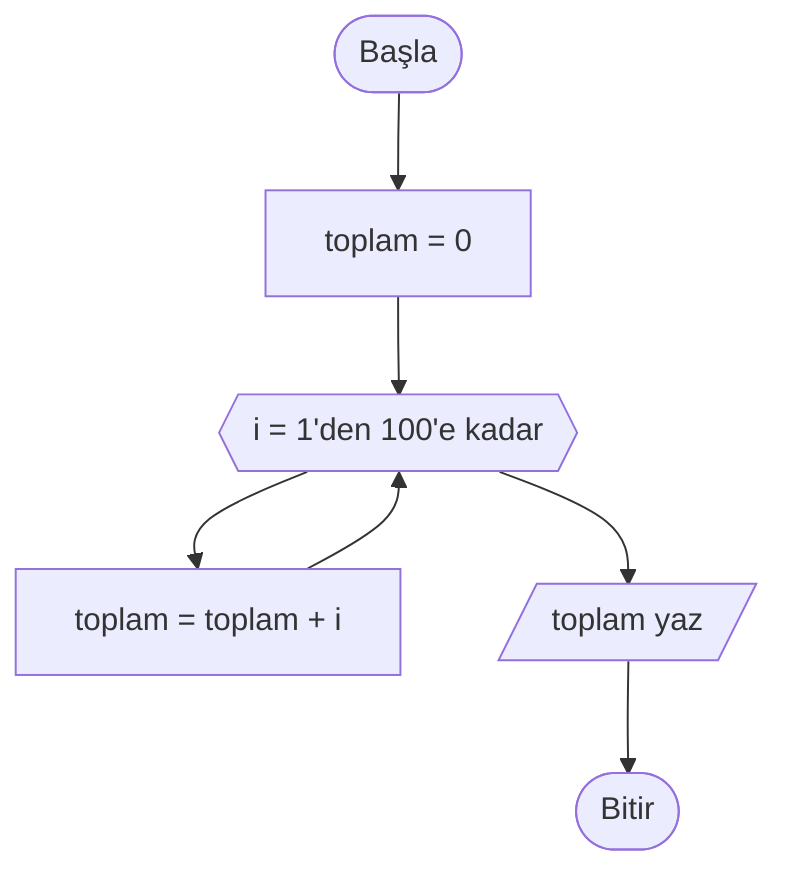
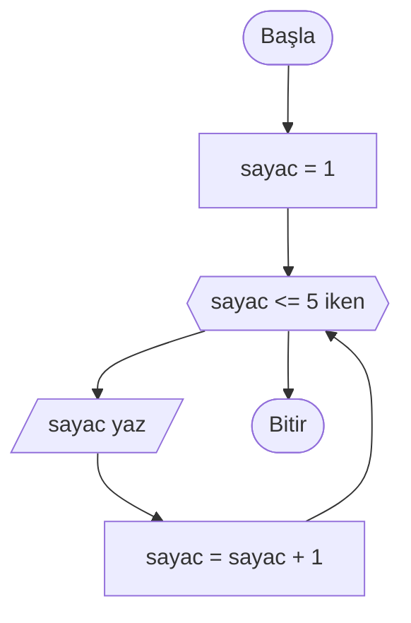
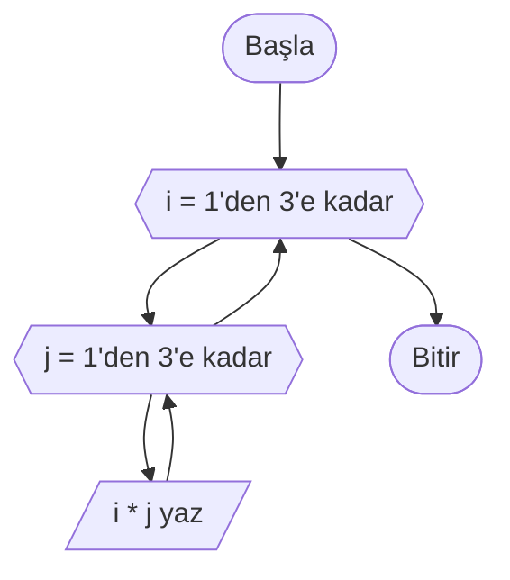

# Döngüler

## 🎯 Bu Bölümde Ne Öğreneceksin?

- Tekrarın neden gerekli olduğunu açıklayacaksın.
- Sayılı döngü ile belirli sayıda tekrar kuracaksın.
- Koşullu döngü ile koşula bağlı tekrar kuracaksın.
- Sayaç ve birikim değişkenlerini kullanacaksın.
- İç içe döngüleri kuracaksın.

## 💡 Neden Önemli?

Bazı işler bir kez yapılmaz; defalarca yapılır. 1'den 100'e kadar olan sayıları
toplamak, bir sınıftaki 30 öğrencinin notunu okumak, bir çarpım tablosunu
yazdırmak... Bu işleri elle yazmaya kalksaydık yüzlerce satır gerekirdi.

Döngüler, aynı adım kümesini istediğimiz kadar tekrarlamamızı sağlar. Böylece
kısa bir sözde kodla çok iş yapabiliriz. Karar yapıları algoritmaya "seçme",
döngüler ise "tekrarlama" yeteneği kazandırır. Bu ikisi birlikte, neredeyse tüm
algoritmaların bel kemiğini oluşturur.

## 🔗 Ön Bilgi

Bölüm 3'te değişkenleri ve `+`, `-`, `mod` gibi işlemleri; Bölüm 4'te koşulları
ve karar yapılarını öğrendin. Döngüler, özellikle Bölüm 4'teki koşul fikrini
tekrar tekrar kullanır.

## ❓ Problem

1'den 100'e kadar olan sayıların toplamını bulman isteniyor. Elimizde şöyle bir
yol var: her sayıyı tek tek toplamak.

```text
toplam = 1 + 2 + 3 + ... + 99 + 100
```

Ama bu, 100 sayı için 100 terim yazmak demektir. Ya 1'den 1.000.000'a kadar
toplamamız istenseydi? Bu yolu takip etmek imkânsız hâle gelir. Peki aynı işi
çok daha kısa biçimde nasıl anlatırız?

## 🤔 Birlikte Düşünelim

Günlük hayattan bir örnek düşün: "Her akşam dişlerini fırçala." Bunu 365 kez
ayrı ayrı yazmanın anlamı yok; tek bir kural söylüyorsun ve o kural her akşam
tekrarlanıyor.

Şimdi kendine sor: Bir algoritmaya "şu adımları, ta ki iş bitene kadar tekrar
et" demenin yolu ne olabilir? Tekrarın kaç kez olacağını biliyorsak ne
yaparız, bilmiyorsak ne yaparız? Cevabını yazmadan devam etme.

Aradığımız şey, adımların etrafına bir halka çizip "bu halkadan koşul sağlandığı
sürece dön" demektir. İşte döngüler tam olarak bunu yapar.

## 🧭 Çözüm Fikri

**Döngü (loop),** bir adım kümesini, belirli bir koşul sağlandığı sürece (ya da
belirli bir sayıda) tekrar çalıştıran yapıdır.

İki tür döngü kullanacağız:

- **Sayılı döngü (counted loop):** Tekrar sayısı önceden bellidir. Örneğin
  "1'den 100'e kadar" gibi.
- **Koşullu döngü (conditional loop):** Tekrar, bir koşul sağlandığı sürece
  devam eder. Kaç kez döneceği önceden bilinmez.

Döngülerde iki yardımcı kavram sık kullanılır:

- **Sayaç (counter):** Kaçıncı tekrarda olduğumuzu tutan değişkendir.
- **Birikim değişkeni (accumulator):** Tekrarlar boyunca biriken bir sonucu
  toplayan değişkendir. Örneğin bir toplam.

> [!IMPORTANT]
> Bir birikim değişkeni kullanmadan önce ona bir başlangıç değeri vermelisin.
> Toplam için bu değer genellikle 0'dır. Aksi hâlde ilk toplama, değeri
> bilinmeyen bir sayıyla yapılmaya çalışılır.

## 📝 Sözde Kod

**Sayılı döngü** şöyle yazılır:

```pseudocode
DÖNGÜ sayac = başlangıç'tan bitiş'e ADIM adım
    ...
DÖNGÜ SONU
```

`sayac` bir sayaç değişkenidir; `başlangıç` değerinden başlar, her turda `adım`
kadar artar ve `bitiş` değerine ulaşınca (dahil) döngü biter.

1'den 100'e kadar olan sayıların toplamını bulalım:

```pseudocode
BAŞLA
    toplam = 0
    DÖNGÜ i = 1'den 100'e ADIM 1
        toplam = toplam + i
    DÖNGÜ SONU
    YAZ toplam
BİTİR
```

Burada `toplam` bir birikim değişkenidir ve 0 ile başlar; `i` ise 1'den 100'e
kadar ilerleyen sayaçtır. Her turda, o anki `i` değeri `toplam`a eklenir.

**Koşullu döngü** ise şöyle yazılır:

```pseudocode
DÖNGÜ koşul İKEN
    ...
DÖNGÜ SONU
```

`koşul` doğru olduğu sürece döngü gövdesi tekrar tekrar çalışır.

```pseudocode
BAŞLA
    sayac = 1
    DÖNGÜ sayac <= 5 İKEN
        YAZ sayac
        sayac = sayac + 1
    DÖNGÜ SONU
BİTİR
```

Bu algoritma 1, 2, 3, 4, 5 sayılarını yazar. `sayac = sayac + 1` satırı çok
önemlidir: sayacı her turda bir artırır. Bu satır olmasaydı koşul hep doğru
kalır ve döngü hiç bitmezdi.

**İç içe döngüler.** Bir döngünün içine başka bir döngü koyabiliriz. Aşağıdaki
algoritma bir çarpım tablosu üretir:

```pseudocode
BAŞLA
    DÖNGÜ i = 1'den 3'e ADIM 1
        DÖNGÜ j = 1'den 3'e ADIM 1
            YAZ i * j
        DÖNGÜ SONU
    DÖNGÜ SONU
BİTİR
```

Dıştaki döngü her bir adımında, içteki döngünün tamamını çalıştırır. Yani 3
satırlık bir çarpım tablosu üretir.

## 🗺️ Akış Şeması

Döngüler akış şemasında **altıgen** sembolüyle gösterilir. Sayılı döngüde
altıgen, sayacın hazırlığını ve döngü aralığını taşır; koşullu döngüde ise
döngü koşulunu taşır. Gövdeden altıgene dönen ok, "tekrar et" anlamı verir.

**Sayılı döngü:**



Gövdeden çıkan okun tekrar altıgene döndüğüne dikkat et: işte döngü bu geri
dönen oktur. Sayaç altıgenin taşıdığı aralığı bitirince döngüden çıkılır ve
sonuç yazılır.

**Koşullu döngü:**



Altıgenin içindeki koşul doğru olduğu sürece gövde tekrar çalışır. Gövdedeki
adım sayacı değiştirdiği için koşul bir gün yanlış olur ve döngü biter.

**İç içe döngüler:**



İçteki altıgen, dıştaki altıgenin gövdesinin içindedir. Dıştaki döngü her
adımında içteki döngünün tamamını çalıştırır; bu yüzden içteki ok önce kendi
altıgenine, dıştaki ok ise bitince dıştaki altıgene döner.

## ⏱️ Elle Çalıştıralım

1'den 5'e kadar toplama işlemini (aynı mantığın küçük hâlini) elle çalıştıralım.

```pseudocode
BAŞLA
    toplam = 0
    DÖNGÜ i = 1'den 5'e ADIM 1
        toplam = toplam + i
    DÖNGÜ SONU
    YAZ toplam
BİTİR
```

| Tur | i değeri | toplam (önce) | toplam (sonra) |
|---|---|---|---|
| 1 | 1 | 0 | 1 |
| 2 | 2 | 1 | 3 |
| 3 | 3 | 3 | 6 |
| 4 | 4 | 6 | 10 |
| 5 | 5 | 10 | 15 |

Beşinci turdan sonra `i` bir artar ve 6 olur. Koşul (`i <= 5`) artık yanlıştır,
döngü biter ve `toplam` olan 15 yazılır.

Şimdi de koşullu döngüyü izleyelim (`sayac <= 3` için):

| Tur | Koşul | Yazılan | sayac (sonra) |
|---|---|---|---|
| 1 | 1 <= 3 doğru | 1 | 2 |
| 2 | 2 <= 3 doğru | 2 | 3 |
| 3 | 3 <= 3 doğru | 3 | 4 |
| 4 | 4 <= 3 yanlış | - | Döngü biter |

## ⚠️ Bir Şeyler Ters Giderse

**Belirti:** Algoritma başlıyor ama bir türlü bitmiyor; döngü hep devam ediyor.

**Olası neden:** Döngünün sonlanma koşulunu etkileyen adım eksiktir. Koşullu
örneğimizde `sayac = sayac + 1` satırını silersen şu hâle gelir:

```pseudocode
BAŞLA
    sayac = 1
    DÖNGÜ sayac <= 5 İKEN
        YAZ sayac
    DÖNGÜ SONU
BİTİR
```

Burada `sayac` hiç değişmez; hep 1 kalır, koşul hep doğru olur ve döngü sonsuza
kadar sürer. Buna **sonsuz döngü** denir.

**Ne yapmalısın?** Döngü gövdesinde, döngü koşulunu bir gün yanlış yapacak bir
adım olduğundan emin ol. Sayılı döngülerde bu adımı sayaç üstlenir; koşullu
döngülerde ise onu sen eklemelisin.

**Bir başka tuzak:** Başlangıç ya da bitiş değerini yanlış seçmek. `1'den
100'e` yazmak istediğin yerde yanlışlıkla `0'dan 99'a` yazarsan toplam yanlış
çıkar. Döngüyü yazmadan önce "ilk değer ne, son değer ne, kaç tur dönmeli?"
sorularını yanıtla.

## ✍️ Kendin Dene

**1.** Kullanıcıdan bir `n` sayısı alıp 1'den `n`'e kadar olan çift sayıların
toplamını bulan bir sözde kod yaz.

**2.** Kullanıcıdan bir `n` sayısı alıp `n` sayısının faktöriyelini hesaplayan
bir algoritma yaz. (Faktöriyel: `1 * 2 * 3 * ... * n`.)

**3.** Bir sınıftaki 5 öğrencinin notunu okuyup ortalamasını bulan bir algoritma
yaz. (Notları tek tek okuyup bir toplamda biriktir; en sonunda 5'e böl.)

<details>
<summary>İpucu</summary>

1. Döngü her turda `i`'yi kontrol et: `i mod 2 == 0` ise toplama ekle.
2. Çarpım için birikim değişkenini 1 ile başlat (`carpim = 1`), sonra her turda
   `i` ile çarp.
3. `toplam` 0 ile başlar; döngü içinde her notu `OKU` ile alıp toplama ekle.

</details>

<details>
<summary>Çözümleri göster</summary>

1. Örnek çözüm:

```pseudocode
BAŞLA
    OKU n
    toplam = 0
    DÖNGÜ i = 1'den n'e ADIM 1
        EĞER i mod 2 == 0 İSE
            toplam = toplam + i
        EĞER SONU
    DÖNGÜ SONU
    YAZ toplam
BİTİR
```

2. Örnek çözüm:

```pseudocode
BAŞLA
    OKU n
    carpim = 1
    DÖNGÜ i = 1'den n'e ADIM 1
        carpim = carpim * i
    DÖNGÜ SONU
    YAZ carpim
BİTİR
```

3. Örnek çözüm:

```pseudocode
BAŞLA
    toplam = 0
    DÖNGÜ i = 1'den 5'e ADIM 1
        OKU not
        toplam = toplam + not
    DÖNGÜ SONU
    ortalama = toplam / 5
    YAZ ortalama
BİTİR
```

</details>

## 🎓 Öğrendiklerini Kontrol Et

**1.** Sayılı döngü ile koşullu döngü arasındaki fark nedir?

**2.** Sayaç ve birikim değişkeni ne işe yarar?

**3.** Sonsuz döngü nasıl oluşur? Bir örnekle açıkla.

**4.** `toplam = 0` satırı bir toplama döngüsünde neden gereklidir?

<details>
<summary>Cevapları göster</summary>

1. Sayılı döngüde tekrar sayısı önceden bellidir (`1'den 100'e` gibi). Koşullu
döngüde tekrar, bir koşul sağlandığı sürece devam eder ve kaç kez döneceği
önceden bilinmeyebilir.

2. Sayaç, kaçıncı tekrarda olduğumuzu tutar. Birikim değişkeni ise tekrarlar
boyunca biriken bir sonucu (örneğin bir toplamı) taşır.

3. Döngü gövdesinde, döngü koşulunu bir gün yanlış yapacak adım yoksa döngü hiç
bitmez. Örneğin koşullu bir döngüde sayacı artırmayı unutursan koşul hep doğru
kalır.

4. Çünkü toplamaya başlamadan önce birikim değişkeninin bir başlangıç değeri
olmalıdır. Bu değer verilmezse ilk toplama, değeri bilinmeyen bir sayıyla
yapılmaya çalışılır.

</details>

## 🚀 Bağımsız Çalışma

Kullanıcıdan bir `n` sayısı isteyen bir algoritma yaz. Algoritma, 1'den `n`'e
kadar olan sayılardan 3'e tam bölünenlerin toplamını bulsun. Önce çözümünü yaz
ve küçük bir `n` değeri (örneğin 10) için elle çalıştır.

Sonra bir değişiklik yap: aynı sayıları bu kez toplamak yerine **saysın**. Bunun
için birikim değişkenini toplam yerine sayım için kullanacaksın. İki sürümü
karşılaştır: hangi satır değişti, neden?

## 📖 Daha Fazlasını Öğrenmek

- Türkçe Vikipedi'nin "Döngü (programlama)" maddesi döngü türlerine kısa bir
  bakış sunar.
- Çevrendeki tekrar eden işleri fark et: bir oyunun turları, bir asansörün
  katları dolaşması, bir müzikçaların çalma listesini sırayla çalması. Her
  birini "DÖNGÜ ... İKEN" ya da "DÖNGÜ ... 'den ... 'e" biçiminde yazmayı dene.

## 📌 Kısa Özet

- Döngü, bir adım kümesini koşul sağlandığı sürece ya da belirli sayıda
  tekrarlar.
- Sayılı döngü `DÖNGÜ sayac = başlangıç'tan bitiş'e ADIM adım` ile yazılır.
- Koşullu döngü `DÖNGÜ koşul İKEN` ile yazılır ve koşul doğru oldukça devam eder.
- Sayaç, kaçıncı tekrarda olduğumuzu; birikim değişkeni, biriken sonucu tutar.
- Döngü gövdesinde koşulu bir gün yanlış yapacak adım yoksa sonsuz döngü oluşur.
- İç içe döngülerle tablo benzeri çıktılar üretilebilir.
- Bir sonraki bölümde, çok sayıda veriyi bir arada saklamayı sağlayan dizileri
  öğreneceksin.

---
[Geri: Karar Yapıları](04-Decision-Structures.md) | [İleri: Diziler](06-Arrays.md)
