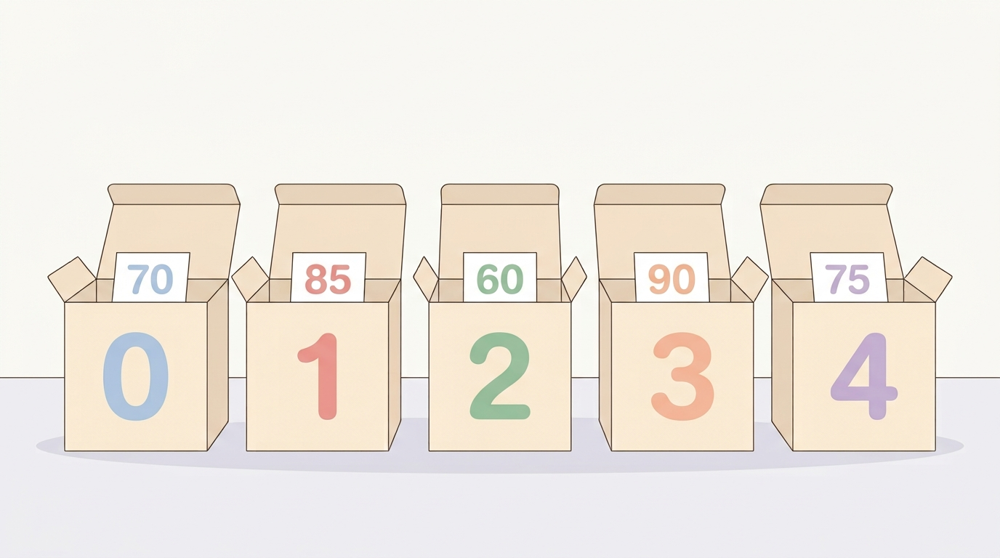
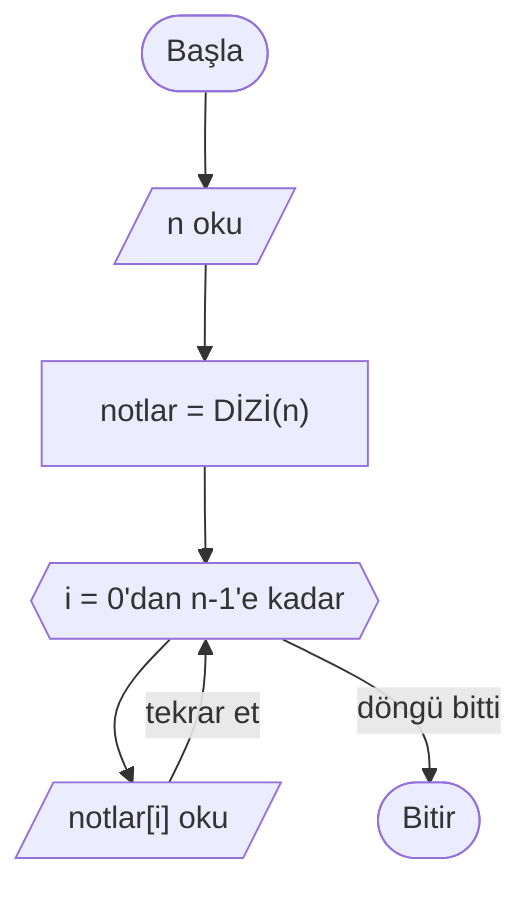
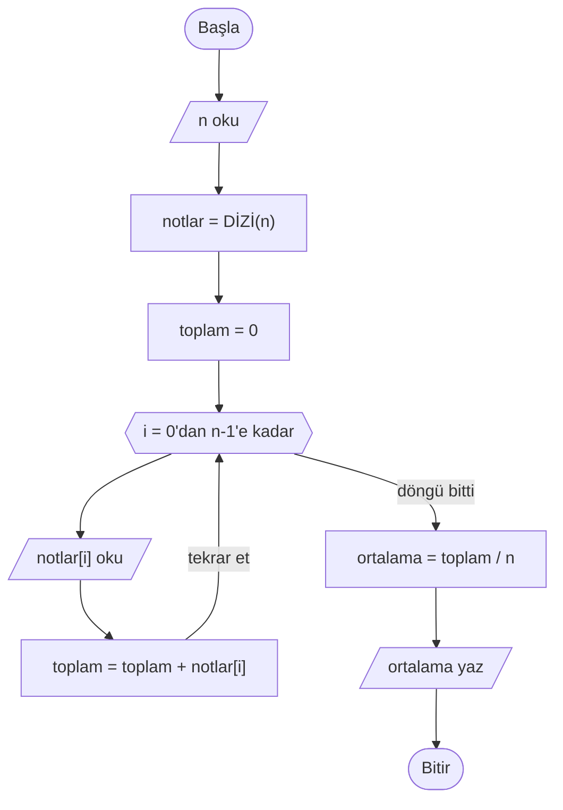
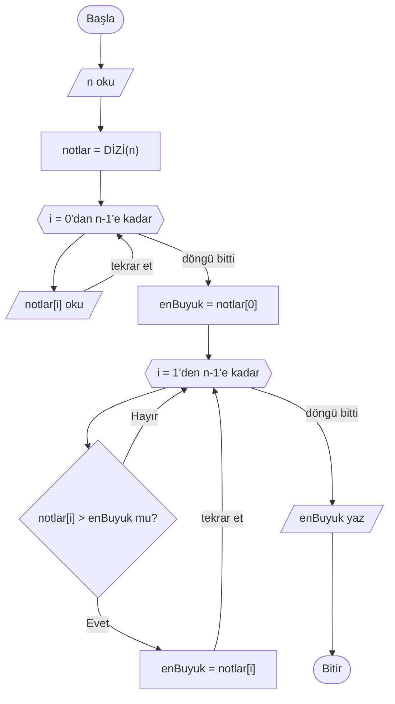

# Diziler

## 🎯 Bu Bölümde Ne Öğreneceksin?

- Dizi kavramını ve neden gerekli olduğunu açıklayacaksın.
- İndeks ve eleman erişimini öğreneceksin.
- Diziye değer yazmayı ve diziden değer okumayı uygulayacaksın.
- Döngüyle bir dizide gezinmeyi öğreneceksin.
- Bir dizi üzerinde toplam, ortalama, en büyük ve en küçük değeri bulacaksın.

## 💡 Neden Önemli?

Şimdiye kadar her değişkende tek bir değer sakladık. Ama bir sınıftaki 30
öğrencinin notunu saklamak istersen ne olur? Tek tek `not1`, `not2`, ...,
`not30` diye 30 değişken tanımlaman gerekir. Bu hem yorucu hem de yönetilemez
bir yoldur; ayrıca bu notları dolaşmak için 30 ayrı işlem yazman gerekir.

Diziler, aynı türden çok sayıda değeri tek bir ad altında toplamamızı sağlar.
Onlarla birlikte, Bölüm 5'te öğrendiğin döngüler gerçek gücüne kavuşur: tek bir
döngüyle 30 notu da, 1.000 notu da aynı biçimde işleyebilirsin.

## 🔗 Ön Bilgi

Bölüm 3'te değişkenleri ve veri tiplerini, Bölüm 5'te döngüleri ve sayaç
kavramını öğrendin. Diziler, bir döngü sayacını konum numarası olarak kullanır;
bu yüzden bu iki konu dizilerin temelidir.

## ❓ Problem

Bir öğretmen, sınıfındaki öğrencilerin notlarını bir algoritma ile işlemek
istiyor. Önce tüm notları saklaması, sonra ortalamayı hesaplaması gerekiyor.
Notları saklamak için öğrenci sayısı kadar ayrı değişken kullanmak istemiyor.

Peki çok sayıda değeri, her birine ayrı bir ad vermeden nasıl saklarız ve sonra
onlara nasıl ulaşırız?

## 🤔 Birlikte Düşünelim

Bir apartmanı düşün. Her dairenin bir numarası vardır: 1, 2, 3... Bir mektubu
teslim etmek için "Ahmet'in dairesi" demek yerine "5 numaralı daire" demek
yeterlidir. Dairelerin hepsi aynı binadadır; onları ayıran şey numaralarıdır.

Şimdi kendine sor: Elimizde art arda numaralanmış kutular olsa ve her kutuda bir
not saklasak, 5. öğrencinin notuna nasıl ulaşırdık? Cevabını yazmadan devam etme.

İhtiyacımız olan şey, içinde birden çok değer barındıran ve her değere bir
numara ile ulaşılan tek bir yapıdır. İşte bu yapı dizidir.

## 🧭 Çözüm Fikri

**Dizi (array),** aynı türden birden çok değeri tek bir ad altında saklayan
yapıdır. Dizideki her değere, o değerin **indeks (index)** numarasıyla
ulaşılır.

Bir diziyi numaralı bir kutu sırası gibi düşün:

```text
indeks:   0     1     2     3     4
değer:   70    85    60    90    75
```

Burada dizinin adı `notlar` olsun. `notlar[0]` 70, `notlar[2]` 60 değerini
tutar. Köşeli parantez içindeki sayı, hangi indeksteki elemandan söz ettiğimizi
gösterir.



> [!IMPORTANT]
> Bu derste dizi indeksleri **0'dan** başlar; yani `n` elemanlı bir dizinin
> geçerli indeksleri 0 ile `n - 1` arasındadır. İlk eleman `notlar[0]`, son
> eleman `notlar[n-1]`'dir. Bu, çoğu programlama dilindeki kullanımla aynıdır;
> yani burada öğrendiğin indeksleme, gerçek kod yazarken de geçerli olacak.

Bir diziyi kullanmadan önce oluştururuz ve kaç eleman alacağını söyleriz:

```pseudocode
notlar = DİZİ(30)
```

Bu satır, 30 elemanlı, adı `notlar` olan bir dizi oluşturur. Ardından her
elemana tek tek değer atayabiliriz:

```pseudocode
notlar[0] = 70
notlar[1] = 85
notlar[29] = 60
```

Burada ilk iki satır dizinin ilk iki elemanına, son satır ise son elemana değer
verir. 30 elemanlı bir dizinin son geçerli indeksi 29 olduğu için son eleman
`notlar[29]`'dur.

## 📝 Sözde Kod

Bir diziyi tek tek doldurmak yerine, döngüyle doldurmak çok daha kullanışlıdır.
Kullanıcıdan önce kaç not girileceğini alıp sonra notları okuyalım:

```pseudocode
BAŞLA
    OKU n
    notlar = DİZİ(n)
    DÖNGÜ i = 0'dan n-1'e ADIM 1
        OKU notlar[i]
    DÖNGÜ SONU
BİTİR
```

Buradaki `i` sayacı, hem döngüyü yürütür hem de o an hangi kutuyu doldurduğumuzu
gösterir. İlk turda `notlar[0]`, ikinci turda `notlar[1]` doldurulur.

Şimdi dizideki notların ortalamasını hesaplayalım:

```pseudocode
BAŞLA
    OKU n
    notlar = DİZİ(n)

    toplam = 0
    DÖNGÜ i = 0'dan n-1'e ADIM 1
        OKU notlar[i]
        toplam = toplam + notlar[i]
    DÖNGÜ SONU

    ortalama = toplam / n
    YAZ ortalama
BİTİR
```

Dizideki en büyük değeri bulalım. Önce ilk elemanı en büyük kabul ederiz; sonra
kalan elemanları gezip daha büyüğünü bulursak güncelleriz:

```pseudocode
BAŞLA
    OKU n
    notlar = DİZİ(n)
    DÖNGÜ i = 0'dan n-1'e ADIM 1
        OKU notlar[i]
    DÖNGÜ SONU

    enBuyuk = notlar[0]
    DÖNGÜ i = 1'den n-1'e ADIM 1
        EĞER notlar[i] > enBuyuk İSE
            enBuyuk = notlar[i]
        EĞER SONU
    DÖNGÜ SONU

    YAZ enBuyuk
BİTİR
```

Dikkat et: döngü `1`'den başlar; çünkü ilk elemanı (indeks 0) baştan en büyük
kabul ettik. En küçük değeri bulmak için de aynı mantığı kullanırız; yalnızca
karşılaştırmayı `notlar[i] < enKucuk` biçiminde yaparız.

## 🗺️ Akış Şeması

Önce diziyi döngüyle dolduran algoritmanın akış şeması:



Şimdi ortalamayı hesaplayan algoritmanın akış şeması:



Son olarak en büyük değeri bulan algoritmanın akış şeması:



Döngünün, dizinin elemanlarını baştan sona gezdiğini görüyorsun. `i` sayacı
aynı zamanda bir indeks görevi görür; bu yüzden döngüyle dizi gezinmek çok
doğaldır.

## ⏱️ Elle Çalıştıralım

Dört notun ortalamasını elle çalıştıralım. Girdiler sırasıyla 60, 80, 100 ve 40
olsun.

| Tur | i | `notlar[i]` | toplam (sonra) |
|---|---|---|---|
| 1 | 0 | 60 | 60 |
| 2 | 1 | 80 | 140 |
| 3 | 2 | 100 | 240 |
| 4 | 3 | 40 | 280 |

Döngü bittikten sonra `ortalama = 280 / 4` hesaplanır; sonuç 70'tir.

Şimdi aynı notlarda en büyüğü bulma algoritmasını izleyelim:

| Tur | i | `notlar[i]` | `notlar[i] > enBuyuk`? | enBuyuk |
|---|---|---|---|---|
| Başlangıç | - | - | - | 60 |
| 1 | 1 | 80 | doğru | 80 |
| 2 | 2 | 100 | doğru | 100 |
| 3 | 3 | 40 | yanlış | 100 |

Sonuç 100 olarak bulunur ve yazılır.

## ⚠️ Bir Şeyler Ters Giderse

**Belirti:** Diziyle çalışan algoritma, anlamsız bir değer veriyor ya da
beklenmedik bir hata üretiyor.

**Olası neden:** Geçersiz bir indekse erişilmiştir. Örneğin 5 elemanlı bir
dizide `notlar[-1]` ya da `notlar[5]` yazmak hatadır; çünkü geçerli indeksler
0'dan 4'e kadardır. Bu duruma **sınır dışı erişim** denir.

**Ne yapmalısın?** İndekslerin dizi sınırları içinde kaldığını kontrol et.
Döngüyle gezinirken en sık yapılan hata, döngüyü yanlış bir değerden başlatmak
ya da `n-1` yerine `n`'e kadar gitmektir. Dizinin ilk indeksinin 0, son
indeksinin `n-1` olduğunu her zaman hatırla.

## ✍️ Kendin Dene

**1.** Kullanıcıdan 5 sayı okuyup bir dizide saklayan, sonra bu sayıların
toplamını yazan bir sözde kod yaz.

**2.** Bir dizideki en küçük sayıyı bulan bir algoritma yaz.

**3.** Bir dizideki sayılardan, dizinin ortalamasından büyük olanları yazan bir
algoritma taslağı kur.

<details>
<summary>İpucu</summary>

1. Diziyi `DİZİ(5)` ile oluştur; döngüyle oku ve toplama ekle.
2. En büyük bulma algoritmasıyla aynıdır; yalnızca karşılaştırmayı `<` yap ve
   başlangıç değerini `enKucuk = dizi[0]` olarak al.
3. Önce ortalamayı hesapla (Bölüm 6'daki algoritma). Sonra ikinci bir döngüde her
   elemanı ortalamayla karşılaştır ve büyük olanları yaz.

</details>

<details>
<summary>Çözümleri göster</summary>

1. Örnek çözüm:

```pseudocode
BAŞLA
    sayilar = DİZİ(5)
    DÖNGÜ i = 0'dan 4'e ADIM 1
        OKU sayilar[i]
    DÖNGÜ SONU
    toplam = 0
    DÖNGÜ i = 0'dan 4'e ADIM 1
        toplam = toplam + sayilar[i]
    DÖNGÜ SONU
    YAZ toplam
BİTİR
```

2. Örnek çözüm:

```pseudocode
BAŞLA
    OKU n
    sayilar = DİZİ(n)
    DÖNGÜ i = 0'dan n-1'e ADIM 1
        OKU sayilar[i]
    DÖNGÜ SONU
    enKucuk = sayilar[0]
    DÖNGÜ i = 1'den n-1'e ADIM 1
        EĞER sayilar[i] < enKucuk İSE
            enKucuk = sayilar[i]
        EĞER SONU
    DÖNGÜ SONU
    YAZ enKucuk
BİTİR
```

3. Örnek çözüm:

```pseudocode
BAŞLA
    OKU n
    sayilar = DİZİ(n)
    DÖNGÜ i = 0'dan n-1'e ADIM 1
        OKU sayilar[i]
    DÖNGÜ SONU

    toplam = 0
    DÖNGÜ i = 0'dan n-1'e ADIM 1
        toplam = toplam + sayilar[i]
    DÖNGÜ SONU
    ortalama = toplam / n

    DÖNGÜ i = 0'dan n-1'e ADIM 1
        EĞER sayilar[i] > ortalama İSE
            YAZ sayilar[i]
        EĞER SONU
    DÖNGÜ SONU
BİTİR
```

</details>

## 🎓 Öğrendiklerini Kontrol Et

**1.** Bir diziyi, tek tek ayrı değişkenlerden ayıran temel fark nedir?

**2.** İndeks ne demektir? `notlar[4]` neyi gösterir?

**3.** `n` elemanlı bir dizide en büyük değeri bulurken döngü neden `1`'den
başlar?

**4.** 5 elemanlı bir dizide `sayilar[4]` geçerli midir? Peki `sayilar[5]`?

<details>
<summary>Cevapları göster</summary>

1. Dizi, aynı türden çok sayıda değeri tek bir ad altında ve indekslerle
saklar. Ayrı değişkenlerde her değerin kendi adı olur ve çok sayıda değeri
dolaşmak zordur.

2. İndeks, dizideki bir elemanın konum numarasıdır. `notlar[4]`, dizinin indeks
4'teki (yani beşinci) elemanını gösterir.

3. Çünkü ilk elemanı (indeks 0) baştan "şu ana kadar görülen en büyük" kabul
ederiz; bu yüzden onunla yeniden karşılaştırma yapmaya gerek yoktur.

4. 5 elemanlı dizide `sayilar[4]` geçerlidir (son elemandır). `sayilar[5]` ise
geçersizdir; sınır dışı erişim olur.

</details>

## 🚀 Bağımsız Çalışma

Kullanıcıdan `n` sayı isteyip bunları bir dizide saklayan, sonra diziyi **ters
sırayla** yazdıran bir algoritma yaz. Ters yazdırmak için döngüyü `n-1`'den 0'a
doğru geriye saydırman gerekecek; bunun için adımı negatif verebilirsin:
`DÖNGÜ i = n-1'den 0'a ADIM -1`.

Önce çözümünü yaz, küçük bir dizi (örneğin 4 eleman) için elle çalıştır ve
sonucun gerçekten ters olduğunu doğrula. Sonra şu soruyu düşün: Diziyi ters
sırayla yazdırmak ile diziyi ters çevirmek aynı şey midir? Neden?

## 📖 Daha Fazlasını Öğrenmek

- Türkçe Vikipedi'nin "Dizi (veri yapısı)" maddesi, dizilerin tanımına ve
  kullanımına kısa bir bakış sunar.
- Kitaplıktaki numaralı raflar, otoparktaki numaralı park yerleri, bir binadaki
  daire numaraları: hepsi birer diziyi andırır. Bu örneklerde "indeks" kavramını
  kendi gözünle düşün.

## 📌 Kısa Özet

- Dizi, aynı türden birden çok değeri tek bir ad altında saklar.
- Dizideki her elemana bir indeks numarasıyla ulaşılır; bu derste indeksler
  0'dan başlar.
- Dizi `notlar = DİZİ(n)` ile oluşturulur; elemanlara `notlar[i]` biçiminde
  erişilir.
- Döngüler dizileri gezmek için idealdir; sayaç aynı zamanda indeks işlevi görür.
- Bir dizide toplam, ortalama ve en büyük/en küçük değer döngülerle kolayca
  bulunur.
- Dizinin sınırları dışındaki bir indekse erişmek hatadır.
- Bir sonraki bölümde, yazdığın algoritmaların doğruluğunu izleme tablolarıyla
  nasıl sınayacağını ve sınır durumlarını nasıl fark edeceğini öğreneceksin.

---
[Geri: Döngüler](05-Loops.md) | [İleri: İzleme ve Sınır Durumları](07-Tracing-And-Testing.md)
