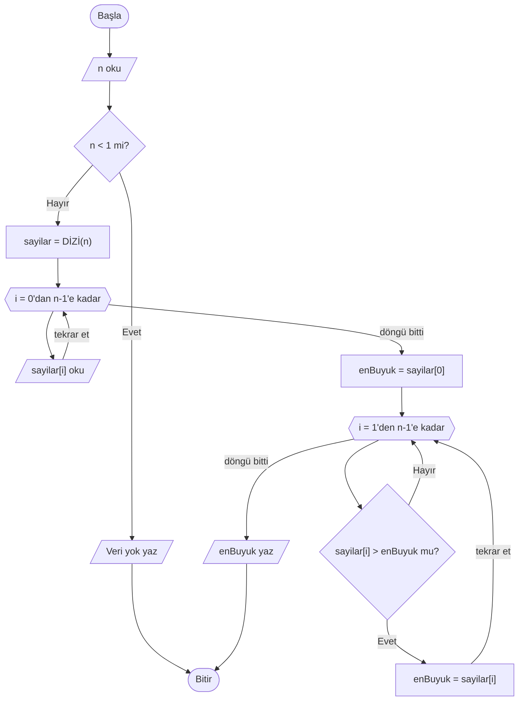

# İzleme ve Sınır Durumları

## 🎯 Bu Bölümde Ne Öğreneceksin?

- Bir algoritmanın doğruluğunu elle sınamayı öğreneceksin.
- İzleme tablosu oluşturarak değişkenleri adım adım izleyeceksin.
- Sınır durumlarını tanıyacak ve sınayacaksın.
- Yaygın hataları bulup düzelteceksin.

## 💡 Neden Önemli?

Şimdiye kadar birçok algoritma yazdın ve çoğunu birkaç örnekle denedin. Ama bir
algoritmanın birkaç örnekte doğru çalışması, her durumda doğru çalışacağı
anlamına gelmez. Hatalar genellikle "normal" görünen girdilerde değil, sınırda
saklanır: verinin hiç olmadığı durumda, tek eleman olduğunda ya da tüm değerler
beklediğinden farklı olduğunda.

Algoritmayı elle, adım adım izlemek; hatayı bulmanın ve onu doğru yerde
düzeltmenin en güvenilir yoludur. Bir algoritmayı bilgisayar çalıştırmadan önce
kendi elinle sınamak, bu dersin en değerli alışkanlıklarından biridir.

## 🔗 Ön Bilgi

Bölüm 5'te döngüleri, Bölüm 6'da dizileri öğrendin. Bu bölüm, şimdiye kadar
yazdığın bütün algoritmalara uygulayabileceğin bir sınama yöntemi sunar.

## ❓ Problem

Aşağıdaki algoritma, bir dizideki en büyük sayıyı bulmayı amaçlıyor:

```pseudocode
BAŞLA
    OKU n
    sayilar = DİZİ(n)
    DÖNGÜ i = 0'dan n-1'e ADIM 1
        OKU sayilar[i]
    DÖNGÜ SONU

    enBuyuk = 0
    DÖNGÜ i = 0'dan n-1'e ADIM 1
        EĞER sayilar[i] > enBuyuk İSE
            enBuyuk = sayilar[i]
        EĞER SONU
    DÖNGÜ SONU

    YAZ enBuyuk
BİTİR
```

Bu algoritmayı 60, 80, 100, 40 girdileriyle denersen sonuç doğru çıkar: 100.
Ama bir sorun var. Sorun nerede olabilir? Gözle bulmak zor; o yüzden elle
izleyeceğiz.

## 🤔 Birlikte Düşünelim

Şimdi aynı algoritmayı tümü negatif olan üç sayıyla çalıştır: -5, -2, -9. Sence
sonuç ne çıkar? Cevabını yazmadan devam etme.

İçinden "en büyük -2'dir" diye geçmiş olabilir; mantıklı. Peki algoritma gerçekten
-2'yi bulur mu? Algoritmanın kalbindeki şu satıra dikkat et:

```pseudocode
enBuyuk = 0
```

Burada `enBuyuk` değişkeni sıfırdan başlıyor. Ama dizideki tüm sayılar negatifse,
hiçbiri sıfırdan büyük değildir; dolayısıyla koşul hiç doğru olmaz ve `enBuyuk`
sıfır olarak kalır. Algoritma yanlışlıkla 0 yazar.

İşte hata, "normal" girdilerde görünmez. Onu ancak sınırda bir girdiyle (tümü
negatif) ve elle izleyerek yakalarız.

## 🧭 Çözüm Fikri

**İzleme tablosu (trace table),** bir algoritmayı elle çalıştırırken her değişkenin
her adımda aldığı değeri bir tabloda göstermenin yoludur. Tablonun satırları
adımları, sütunları ise değişkenleri temsil eder. Tabloyu doldururken işlemleri
gerçekten hesaplarsın; böylece hata varsa hangi adımda ortaya çıktığını
net görürsün.

**Sınır durumu (edge case),** bir algoritmanın girişinin alabileceği uç
değerlerdir. Tipik sınır durumları şunlardır:

- Veri hiç yok (boş).
- Tek eleman var.
- Bütün elemanlar birbirine eşit.
- Bütün elemanlar negatif ya da sıfır.
- Değerler beklenenin en küçüğü ya da en büyüğü.

Bir algoritmayı sınamak için önce birkaç normal örnek seç, sonra bu sınır
durumlarını tek tek dene. Algoritma normalde doğru, sınırda yanlış çalışıyorsa
sorun büyük olasılıkla bir başlangıç değerinde ya da bir döngü sınırındadır.

## 📝 Sözde Kod

Az önceki hatayı düzeltelim. Sorun, `enBuyuk` değişkenine verilen başlangıç
değeriydi. Doğru yaklaşım, ilk elemanı baştan "en büyük" kabul etmektir. Ancak
dizi boşsa ilk eleman da olmayacağı için, önce "veri var mı?" diye kontrol
etmeliyiz:

```pseudocode
BAŞLA
    OKU n

    EĞER n < 1 İSE
        YAZ "Veri yok"
    DEĞİLSE
        sayilar = DİZİ(n)
        DÖNGÜ i = 0'dan n-1'e ADIM 1
            OKU sayilar[i]
        DÖNGÜ SONU

        enBuyuk = sayilar[0]
        DÖNGÜ i = 1'den n-1'e ADIM 1
            EĞER sayilar[i] > enBuyuk İSE
                enBuyuk = sayilar[i]
            EĞER SONU
        DÖNGÜ SONU

        YAZ enBuyuk
    EĞER SONU
BİTİR
```

Bu sürüm, hangi değerler gelirse gelsin doğru çalışır; çünkü başlangıç değeri
artık dizinin gerçek bir elemanıdır ve boş veri durumu ayrıca ele alınmıştır.

## 🗺️ Akış Şeması

Düzeltilmiş en büyük bulma algoritmasının akış şeması:



Karar düğümündeki iki yol da (güncelleme yapıldıktan ya da yapılmadıktan
sonra) altıgene geri döner; çünkü döngü, dizinin tüm elemanları bitene kadar
sürer.

## ⏱️ Elle Çalıştıralım

Önce hatalı sürümü (-5, -2, -9) ile izleyelim:

| Adım | i | sayilar[i] | Koşul (`> enBuyuk`) | enBuyuk |
|---|---|---|---|---|
| Başlangıç | - | - | - | 0 |
| 1 | 0 | -5 | -5 > 0 yanlış | 0 |
| 2 | 1 | -2 | -2 > 0 yanlış | 0 |
| 3 | 2 | -9 | -9 > 0 yanlış | 0 |

Sonuç 0 yazılır; beklenen -2'ydi. Hata doğrulandı.

Şimdi düzeltilmiş sürümü aynı girdiyle izleyelim:

| Adım | i | sayilar[i] | Koşul (`> enBuyuk`) | enBuyuk |
|---|---|---|---|---|
| Başlangıç | - | - | - | -5 |
| 1 | 1 | -2 | -2 > -5 doğru | -2 |
| 2 | 2 | -9 | -9 > -2 yanlış | -2 |

Sonuç -2 yazılır; doğru.

Bir de boş veri sınır durumunu deneyelim: `n == 0` girilirse, `n < 1` koşulu
doğru olur ve algoritma "Veri yok" yazar. Düzeltilmemiş sürümde ise bu durumda
`sayilar[0]`'a erişilmeye çalışılır ve sınır dışı erişim hatası oluşurdu.

## ⚠️ Bir Şeyler Ters Giderse

Algoritmalarda en sık karşılaşacağın hata kalıpları şunlardır:

- **Yanlış başlangıç değeri.** Bir toplamı 0 yerine başka bir değerle başlatmak
  ya da bir "en büyük" değişkenini 0 gibi sabit bir değerle başlatmak. Başlangıç
  değerini her zaman dizinin gerçek bir elemanından ya da işin doğasından türet.
- **Yanlış döngü sınırı.** "En büyük" döngüsünü 0 yerine 1'den başlatıp ilk
  elemanı atlamak ya da `n-1` yerine `n`'e kadar gidip sınır dışına taşmak.
  Döngü sınırlarını yazarken ilk ve son turun ne olacağını tek tek söyle.
- **Karşılaştırmada eşitliği atlamak.** `>` yazılması gereken yerde `>=` (ya da
  tersi) kullanmak. Eşitlik durumunun sonucu değiştirip değiştirmediğini sor.
- **Güncellemeyi unutmak.** Bir döngüde sayacı artırmayı ya da bir değeri
  güncellemeyi atlamak; bu, yanlış sonuçlara ya da sonsuz döngüye yol açar.

**Ne yapmalısın?** Bir hata şüphesi duyduğunda önce bir izleme tablosu doldur.
Ardından, hatanın görünmediği bir değil birkaç sınır durumu dene. Hangi adımda
beklenen değerden saptığını bulduğunda, hata genellikle kendini gösterir.

## ✍️ Kendin Dene

**1.** Aşağıdaki izleme tablosunda boş hücreleri doldur. Algoritma, `sayilar`
dizisindeki (3, 7, 5) sayılarının toplamını buluyor.

| Tur | i | sayilar[i] | toplam (sonra) |
|---|---|---|---|
| 1 | 0 | 3 | ? |
| 2 | 1 | 7 | ? |
| 3 | 2 | 5 | ? |

**2.** Aşağıdaki algoritmada bir hata var. Hatayı bul ve nedenini açıkla:

```pseudocode
BAŞLA
    OKU n
    sayilar = DİZİ(n)
    DÖNGÜ i = 0'dan n'e ADIM 1
        OKU sayilar[i]
    DÖNGÜ SONU
BİTİR
```

**3.** "İki sayının bölümünü bulan" bir algoritma için hangi sınır durumlarını
sınamalısın? En az iki tanesini yaz.

<details>
<summary>İpucu</summary>

1. Her turda toplam, önceki toplama o anki elemanı ekler.
2. Bu derste dizi indeksleri 0'dan başlar; son geçerli indeksin ne olduğunu
   düşün.
3. Bölme işleminde payda (bölen) ile ilgili özel bir değer düşün.

</details>

<details>
<summary>Çözümleri göster</summary>

1. Sırasıyla: `toplam` 3, sonra 10, sonra 15 olur. Sonuç 15'tir.

2. Hata, döngünün `n`'e kadar gitmesidir. Bu derste dizi indeksleri 0'dan
   başladığı için `n` elemanlı bir dizinin son geçerli indeksi `n-1`'dir.
   `i == n` olduğunda `sayilar[n]` diye bir eleman yoktur; sınır dışı erişim
   olur. Döngü `0'dan n-1'e` olmalıdır.

3. Bölenin 0 olduğu durum (sıfıra bölme tanımsızdır); payın 0 olduğu durum;
   iki negatif sayının bölümü; payın bölenden küçük olduğu durum. Bu durumların
   sonuçlarını önceden tahmin edip algoritmanın bunları doğru karşıladığını
   kontrol etmelisin.

</details>

## 🎓 Öğrendiklerini Kontrol Et

**1.** İzleme tablosu nedir ve ne işe yarar?

**2.** Sınır durumu ne demektir? Üç örnek sırala.

**3.** "En büyük" değişkenini sabit bir değerle (örneğin 0) başlatmak neden
tehlikelidir?

**4.** Bir döngünün başlangıç ve bitiş değerlerini seçerken hangi soruları
sormalısın?

<details>
<summary>Cevapları göster</summary>

1. İzleme tablosu, bir algoritmayı elle çalıştırırken her değişkenin her adımda
aldığı değeri gösteren bir tablodur. Algoritmanın adım adım doğru gidip
gitmediğini sınamak için kullanılır.

2. Sınır durumu, girdinin alabileceği uç değerlerdir. Örnekler: boş veri, tek
eleman, bütün elemanların eşit olması, bütün elemanların negatif olması.

3. Çünkü dizi değerleri bu sabit değerin ötesine geçmediğinde sonuç yanlış
çıkar. Örneğin tüm sayılar negatifken "en büyük" 0 olarak kalır. Doğrusu,
başlangıç değerini dizinin gerçek bir elemanından almaktır.

4. "İlk turda hangi değer basılmalı? Son turda hangi değer basılmalı? Kaç tur
dönmeli? Döngü bittiğinde sayaç hangi değerde olur?" sorularını sormalısın.

</details>

## 🚀 Bağımsız Çalışma

Bölüm 6'da yazdığın "notların ortalamasını bulma" algoritmasını eline al. Onu üç
sınır durumuyla sına: (1) tek not girilmesi, (2) bütün notların aynı olması,
(3) not sayısının 0 girilmesi.

Her durum için önce sonucun ne olması gerektiğini tahmin et, sonra izleme
tablosuyla sına. Üçüncü durumda bir sorun bulacaksın; ortalamayı hesaplarken
`toplam / n` ifadesinde `n` sıfır olursa ne olur? Bu sorunu gidermek için
algoritmana küçük bir karar yapısı ekle ve çözümünü yeniden sına.

## 📖 Daha Fazlasını Öğrenmek

- "Sıfıra bölme" neden tanımsızdır ve programlarda neden hataya yol açar?
  Türkçe kaynaklarda "sıfıra bölme" konusunu araştır.
- Yazılımda test etme konusunun günlük adı "test"tir; bir algoritmayı sınarken
  kullandığın bu yöntem, gerçek yazılım testlerinin küçük bir başlangıcıdır.
  İleride bu konuyu daha derin öğreneceksin.

## 📌 Kısa Özet

- İzleme tablosu, değişkenlerin adım adım aldığı değerleri göstererek bir
  algoritmayı elle sınamayı sağlar.
- Sınır durumları; boş veri, tek eleman, tüm elemanların eşit ya da negatif
  olması gibi uç girdilerdir.
- Hatalar çoğu zaman normal örneklerde değil, sınır durumlarında görünür.
- En sık hata kalıpları: yanlış başlangıç değeri, yanlış döngü sınırı, eşitliğin
  atlanması ve güncellemenin unutulması.
- Bir algoritmayı güvenilir saymak için hem normal hem sınır durumlarını
  sınamalısın.
- Bir sonraki bölümde, öğrendiklerini gerçek algoritmalara uygulayacağız:
  arama algoritmaları.

---
[Geri: Diziler](06-Arrays.md) | [İleri: Arama Algoritmaları](08-Search-Algorithms.md)
