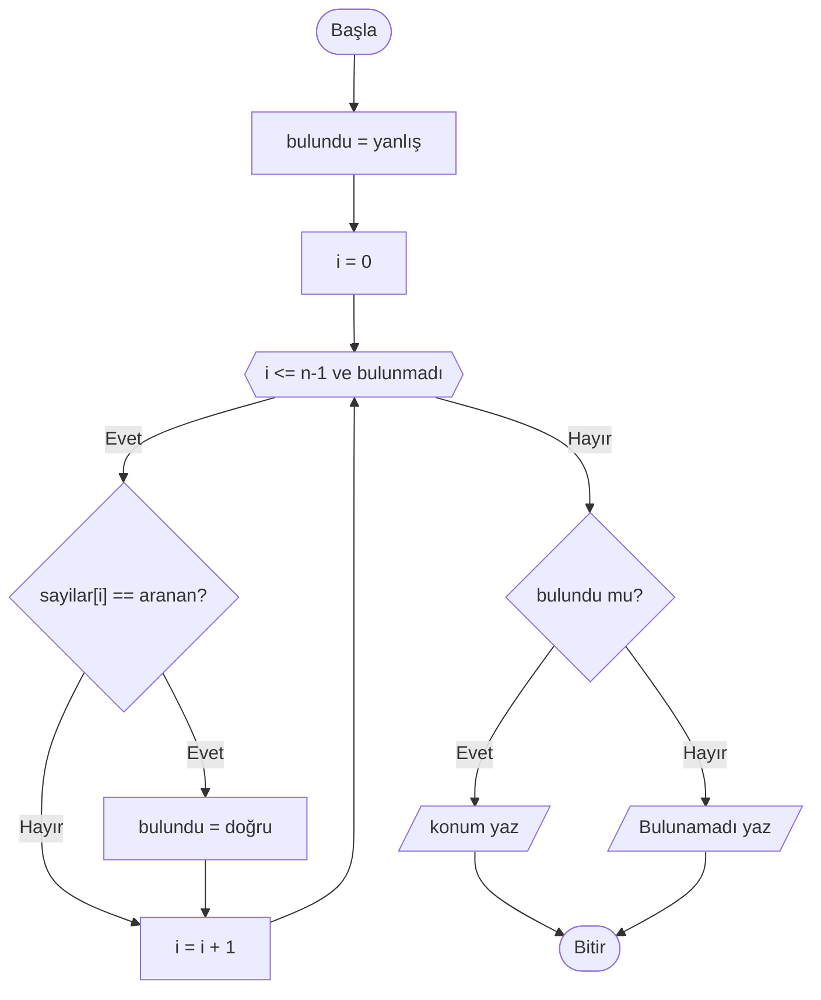
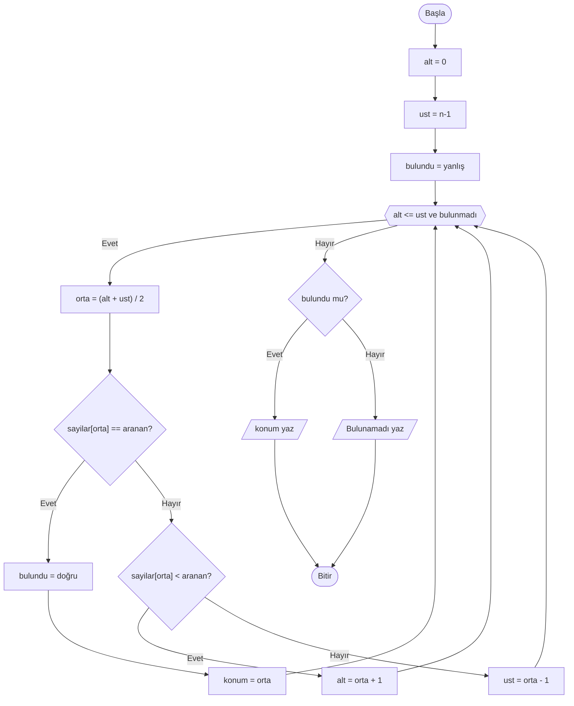

# Arama Algoritmaları

## 🎯 Bu Bölümde Ne Öğreneceksin?

- Arama problemini tanımlayacaksın.
- Doğrusal aramayı öğrenecek ve uygulayacaksın.
- Sıralı bir dizide ikili aramayı öğrenecek ve uygulayacaksın.
- İki yöntemi, hangi durumda hangisinin uygun olduğuna göre karşılaştıracaksın.

## 💡 Neden Önemli?

Arama, bilgisayarların en sık yaptığı işlerden biridir: bir listede bir ismi, bir
dosya sisteminde bir dosyayı, bir rehberde bir numarayı aramak. Aynı problemi
birden çok yolla çözebileceğimizi görmek, algoritma düşüncesinin en öğretici
yanlarından biridir.

Bu bölümde iki arama yöntemi öğreneceksin. İkisi de aynı sonucu verir; ama biri
belirli bir koşulda çok daha hızlıdır. Bu, "doğru çalışmak" ile "verimli
çalışmak" arasındaki farkı ilk kez somut biçimde görmeni sağlayacak.

## 🔗 Ön Bilgi

Bölüm 6'da dizileri, Bölüm 7'de izleme tablosu ve sınır durumlarını öğrendin.
Arama algoritmaları bu iki konunun doğal bir uygulamasıdır; ayrıca Bölüm 5'te
öğrendiğin döngüleri ve Bölüm 4'teki karar yapılarını yoğun biçimde kullanır.

## ❓ Problem

Elimizde bir dizi ve aranan bir değer var. Dizide bu değerin olup olmadığını,
varsa hangi konumda olduğunu bulmak istiyoruz. Örneğin `[4, 9, 2, 7]` dizisinde
7 sayısını arayalım.

En basit yol, baştan başlayıp her elemana tek tek bakmaktır. Peki ya dizi çok
büyükse? 1.000.000 elemanlı bir dizide aranan değer en sonda olsa, tek tek
bakmak çok yavaş kalır. Daha hızlı bir yol var mı?

## 🤔 Birlikte Düşünelim

Bir sözlükte bir kelime ararken ne yaparsın? Sözlüğü ilk sayfadan başlayıp
kelime kelime okumazsın. Sözlüğü yaklaşık ortasından açarsın; baktığın sayfadaki
kelime aradığından alfabetik olarak sonraysa geriye, önceyse ileriye gidersin.
Birkaç denemede kelimeyi bulursun.

Şimdi kendine sor: Sözlükte bu yöntemi kullanabilmemizin nedeni ne? Sözlükteki
kelimeler belirli bir sırada dizilmiş midir? Peki karışık sıralanmış bir
listede aynı numarayı yapabilir miydik? Cevabını yazmadan devam etme.

Sözlük yönteminin işe yaramasının tek nedeni, kelimelerin alfabetik olarak
sıralı olmasıdır. Aynı fikir, sıralı bir sayı dizisinde de işe yarar ve bizi çok
daha hızlı bir aramaya götürür.


## 🧭 Çözüm Fikri

**Doğrusal arama (linear search),** diziyi baştan sona gezip her elemanı aranan
değerle karşılaştırır. Değeri bulursa konumunu verir; bulamazsa "yok" der. Basit
ve güvenilirdir; dizinin sıralı olmasını gerektirmez.

**İkili arama (binary search),** yalnızca **sıralı** dizilerde çalışır. Mantığı
şudur: dizinin ortasındaki elemana bak. Aradığın değer ortadaki elemana eşitse
buldun. Aradığın değer ortadakinden büyükse, aradığın değer dizinin sağ
yarısındadır; sol yarıyı tamamen bırakabilirsin. Küçükse sağ yarıyı bırakırsın.
Böylece her adımda arama alanı yaklaşık yarıya iner.

İkili aramanın gücü bu "yarıya indirme" fikrindedir. Çok büyük bir dizide bile
çok az sayıda karşılaştırmayla sonuca ulaşır. Örneğin 1.000.000 elemanlı bir
dizide doğrusal arama en kötü durumda 1.000.000 karşılaştırma yaparken, ikili
arama yalnızca 20 civarı karşılaştırma yapar.

> [!IMPORTANT]
> İkili arama, dizinin sıralı olduğunu varsayar. Sıralı olmayan bir dizide
> kullanırsan yanlış sonuç alırsın; çünkü "sol yarıda değildir" çıkarımı ancak
> sıralı bir dizide geçerlidir.

## 📝 Sözde Kod

**Doğrusal arama.** Bulunduğunda döngüden çıkmak için bir mantıksal değişken
kullanırız:

```pseudocode
BAŞLA
    OKU n
    sayilar = DİZİ(n)
    DÖNGÜ i = 0'dan n-1'e ADIM 1
        OKU sayilar[i]
    DÖNGÜ SONU

    OKU aranan
    bulundu = yanlış
    konum = 0

    i = 0
    DÖNGÜ (i <= n-1) VE (bulundu == yanlış) İKEN
        EĞER sayilar[i] == aranan İSE
            bulundu = doğru
            konum = i
        EĞER SONU
        i = i + 1
    DÖNGÜ SONU

    EĞER bulundu İSE
        YAZ konum
    DEĞİLSE
        YAZ "Bulunamadı"
    EĞER SONU
BİTİR
```

`bulundu` değişkeni bir mantıksal değerdir (`doğru`/`yanlış`). Değeri bulunca
`doğru` yapılır ve döngü koşulu `bulundu == yanlış` kısmı sayesinde döngü sona
erer.

**İkili arama.** Arama alanını iki değişkenle, `alt` ve `ust` ile tutarız:

```pseudocode
BAŞLA
    OKU n
    sayilar = DİZİ(n)
    DÖNGÜ i = 0'dan n-1'e ADIM 1
        OKU sayilar[i]          # dizi SIRALI olmalı
    DÖNGÜ SONU

    OKU aranan
    alt = 0
    ust = n-1
    bulundu = yanlış

    DÖNGÜ (alt <= ust) VE (bulundu == yanlış) İKEN
        orta = (alt + ust) / 2
        EĞER sayilar[orta] == aranan İSE
            bulundu = doğru
            konum = orta
        DEĞİLSE EĞER sayilar[orta] < aranan İSE
            alt = orta + 1
        DEĞİLSE
            ust = orta - 1
        EĞER SONU
    DÖNGÜ SONU

    EĞER bulundu İSE
        YAZ konum
    DEĞİLSE
        YAZ "Bulunamadı"
    EĞER SONU
BİTİR
```

`alt` ve `ust`, arama yapılan aralığın sınırlarıdır. Her turda bu aralık
daralır. Aradığımız değer ortadaki elemandan büyükse `alt`ı ortadan sonraya
taşırız; küçükse `ust`u ortadan önceye çekeriz.

> [!NOTE]
> `orta` değeri bir indeks olduğu için tam sayı olmalıdır. `(alt + ust) / 2`
> işlemi tek sayı verirse, bölme sonucunun tam kısmını alırız. Örneğin
> `(0 + 5) / 2` işleminin sonucu 2.5'tir; biz `orta` olarak 2'yi kullanırız.
> Gerçek kod yazarken bu ayrımı ayrıca belirtmen gerekecek.

## 🗺️ Akış Şeması

**Doğrusal arama.** Bu şema, döngü ve karar yapılarının bir arada nasıl
çalıştığını güzel biçimde gösterir:



`E` elması değerin bulunup bulunmadığını, `H` elması ise sonucun ne olduğunu
belirler. Döngü, `D` altıgeninden `G` kutusuna, oradan tekrar `D`'ye dönen oktur.

**İkili arama.** Bu şema, her turda arama alanının nasıl daraldığını gösterir:



`G` elması ortadaki elemanın aranan olup olmadığını, `J` elması ise aramanın
hangi yarıda süreceğini belirler. `E` altıgeni döngü koşulunu taşır; gövdeden
çıkan oklar tekrar `E`'ye döner.

## ⏱️ Elle Çalıştıralım

**Doğrusal arama.** `[4, 9, 2, 7]` dizisinde 7'yi arayalım:

| Tur | i | sayilar[i] | Eşit mi? | bulundu |
|---|---|---|---|---|
| 1 | 0 | 4 | hayır | yanlış |
| 2 | 1 | 9 | hayır | yanlış |
| 3 | 2 | 2 | hayır | yanlış |
| 4 | 3 | 7 | evet | doğru |

Döngü 4. turda biter, konum 3 olarak yazılır. Toplam 4 karşılaştırma yapıldı.

**İkili arama.** Sıralı `[2, 4, 7, 9, 11]` dizisinde 11'i arayalım:

| Tur | alt | ust | orta | sayilar[orta] | Karar |
|---|---|---|---|---|---|
| 1 | 0 | 4 | 2 | 7 | 7 < 11, sol yarı atılır; alt = 3 |
| 2 | 3 | 4 | 3 | 9 | 9 < 11, alt = 4 |
| 3 | 4 | 4 | 4 | 11 | Bulundu, konum 4 |

İkili arama aynı sonuca yalnızca 3 karşılaştırmada ulaştı; üstelik dizi
büyüdükçe bu fark çok daha artar. Dikkat et: 1. turda `orta` için `(0 + 4) / 2 = 2`
kullandık; 2. turda `(3 + 4) / 2 = 3.5` çıktı ve tam kısmı olan 3'ü aldık.

## ⚠️ Bir Şeyler Ters Giderse

**Belirti:** İkili arama, dizide gerçekten var olan bir değeri bulamıyor ya da
yanlış konum veriyor.

**Olası neden:** Dizi sıralı değildir. İkili arama, "aradığım değer ortadakinden
büyükse sağ yarıdadır" varsayımına dayanır. Dizi sıralı değilse bu varsayım
çöker.

**Ne yapmalısın?** İkili aramayı kullanmadan önce dizinin sıralı olduğundan emin
ol. Sıralama yapmadan arama gerekiyorsa doğrusal aramayı kullan.

**Bir başka tuzak:** `alt` ve `ust` güncellemelerinde küçük hatalar. `alt = orta`
yazmak yerine `alt = orta + 1`, `ust = orta` yerine `ust = orta - 1` yazmak
gerekir. Bu `+1` ve `-1` olmazsa arama aynı elemanın üzerinde takılıp kalabilir
ya da doğru elemanı atlayabilir. Döngünün her turda ilerlediğinden emin ol.

## ✍️ Kendin Dene

**1.** `[5, 3, 8, 1]` dizisinde doğrusal aramayla 3'ü ara. Kaç karşılaştırma
yapılır? Konum kaçtır?

**2.** Sıralı `[1, 3, 5, 8, 9, 12]` dizisinde ikili aramayla 8'i ara. Her turda
`alt`, `ust` ve `orta` değerlerini yazarak ilerle.

**3.** İkili arama neden yalnızca sıralı dizilerde çalışır? Bir cümleyle açıkla.

<details>
<summary>İpucu</summary>

1. İlk elemandan başla; eşit çıktığında dur.
2. Dizinin ortasını bul (`alt` ve `ust`in ortalaması, tam kısmı); karşılaştır ve
   yarıyı at.
3. "Sol yarıda değildir" çıkarımı neye dayanıyor?

</details>

<details>
<summary>Çözümleri göster</summary>

1. 1. tur: 5 (hayır), 2. tur: 3 (evet). 2 karşılaştırma; konum 1.

2. alt = 0, ust = 5, orta = 2 -> `sayilar[2] = 5`; 5 < 8, alt = 3.
   alt = 3, ust = 5, orta = 4 -> `sayilar[4] = 9`; 9 > 8, ust = 3.
   alt = 3, ust = 3, orta = 3 -> `sayilar[3] = 8`; bulundu, konum 3.
   Toplam 3 karşılaştırma.

3. Çünkü ikili arama, ortadaki değerle karşılaştırıp aradığı değerin hangi
   yarıda olduğunu çıkarır. Bu çıkarım ancak elemanlar sıralıysa geçerlidir.

</details>

## 🎓 Öğrendiklerini Kontrol Et

**1.** Doğrusal arama ile ikili arama arasındaki temel fark nedir?

**2.** İkili arama hangi koşulda çalışır? Bu koşul sağlanmazsa ne olur?

**3.** Doğrusal aramada `bulundu` değişkeni ne işe yarar?

**4.** Çok büyük bir sıralı dizide neden ikili arama tercih edilir?

<details>
<summary>Cevapları göster</summary>

1. Doğrusal arama elemanları baştan sona tek tek gezer ve sıralı dizi
gerektirmez. İkili arama ortadan başlar, her adımda arama alanını yarıya indirir
ve yalnızca sıralı dizide çalışır.

2. İkili arama, dizinin sıralı olması koşuluyla çalışır. Sıralı değilse yanlış
sonuç verir; çünkü hangi yarıyı atacağını doğru çıkaramaz.

3. Değerin bulunup bulunmadığını tutar. Bulunca `doğru` olur ve döngünün erken
bitmesini sağlar.

4. Çünkü her adımda arama alanını yarıya indirdiğinden, çok büyük dizilerde bile
az sayıda karşılaştırmayla sonuca ulaşır.

</details>

## 🚀 Bağımsız Çalışma

Bir düşünce deneyi yapalım. 1.000 elemanlı sıralı bir dizide aradığın değer en
sonda olsun.

- Doğrusal arama en kötü durumda kaç karşılaştırma yapar?
- İkili arama için, arama alanını her adımda yarıya indirerek kaç adımda tek
  eleman kalır? Say: 1.000 -> 500 -> 250 -> ... Kaç adım sonra 1'e iniyorsun?
- İki sayıyı karşılaştır.

Sonra aynı hesabı 2.000 ve 4.000 eleman için yap. Dizi boyu iki katına
çıktığında ikili aramanın adım sayısı ne kadar artıyor? Buradan çıkan sonucu bir
cümleyle yaz.

## 📖 Daha Fazlasını Öğrenmek

- Türkçe Vikipedi'nin "Arama algoritması", "Doğrusal arama" ve "İkili arama"
  maddeleri bu yöntemlere kısa bir bakış sunar.
- Günlük hayatta ikili arama mantığını nerede kullandığını fark et: bir sözlük,
  alfabetik bir rehber, bir kitabın dizini. Her birinde ortadan başlayıp yarıyı
  eleme fikrini gör.

## 📌 Kısa Özet

- Arama, bir dizide belirli bir değeri bulma işlemidir.
- Doğrusal arama her elemanı sırayla kontrol eder; sıralı dizi gerektirmez.
- İkili arama yalnızca sıralı dizide çalışır; her adımda arama alanını yarıya
  indirir.
- İkili arama, büyük dizilerde doğrusal aramadan çok daha az karşılaştırma yapar.
- Mantıksal `bulundu` değişkeni, değer bulunduğunda döngüyü erken bitirmek için
  kullanılır.
- Bir sonraki bölümde, ikili aramanın ön koşulu olan sıralamayı öğreneceksin:
  bir diziyi küçükten büyüğe dizen algoritmalar.

---
[Geri: İzleme ve Sınır Durumları](07-Tracing-And-Testing.md) | [İleri: Sıralama Algoritmaları](09-Sorting-Algorithms.md)
