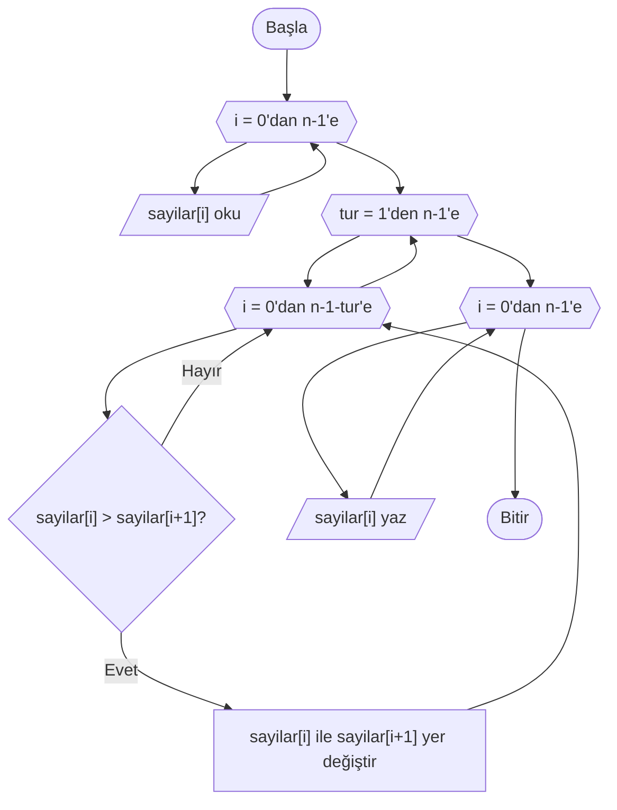
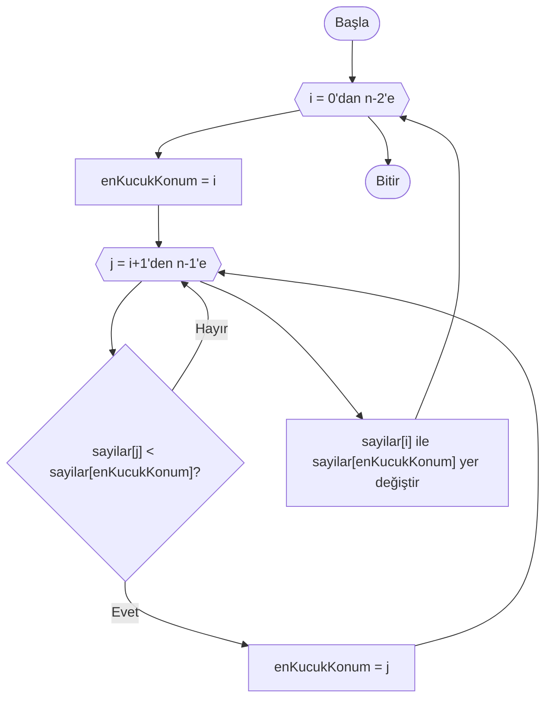

# Sıralama Algoritmaları

## 🎯 Bu Bölümde Ne Öğreneceksin?

- Sıralama problemini ve neden gerekli olduğunu açıklayacaksın.
- Kabarcık sıralama algoritmasını öğrenecek ve uygulayacaksın.
- Seçmeli sıralama algoritmasını öğrenecek ve uygulayacaksın.
- İki yöntemi karşılaştıracaksın.

## 💡 Neden Önemli?

Bölüm 8'de ikili aramanın yalnızca **sıralı** dizilerde çalıştığını gördün. Yani
sıralama, hızlı aramanın ön koşuludur. Ama sıralamanın faydası bununla sınırlı
değildir: bir listede en küçüğü ya da en büyüğü bulmak, iki listeyi
karşılaştırmak, bir tabloyu düzene sokmak gibi pek çok iş, sıralı veriyle çok
daha kolay hâle gelir.

Sıralamanın birden çok yolu olduğunu görmek, "aynı işi farklı yaklaşımlarla
yapabilme" fikrini pekiştirir. Bu bölümde iki klasik yöntem öğreneceksin.

## 🔗 Ön Bilgi

Bölüm 6'da dizileri, Bölüm 5'te iç içe döngüleri, Bölüm 4'te karar yapılarını
öğrendin. Sıralama algoritmaları, bunların hepsini bir arada kullanır.

## ❓ Problem

Elimizde sıralanmamış bir sayı dizisi var: `[5, 3, 8, 1]`. Bunu küçükten büyüğe
dizmek istiyoruz; sonuç `[1, 3, 5, 8]` olmalı.

İnsan olarak bunu gözle yapabiliriz. Peki bir algoritmaya, "bu sayıları sıraya
diz" demeyi nasıl öğretiriz? İşin zor kısmı, sıralamanın tek bir işlemle
olmamasıdır; küçük adımlarla, karşılaştırarak ve yer değiştirerek ilerlemesi
gerekir.

## 🤔 Birlikte Düşünelim

Elinde karışık bir deste oyun kartı olduğunu düşün. Kartları büyükten küçüğe
dizmek istiyorsun. Nasıl başlarsın?

Bir yol şudur: tüm kartlara bakıp en büyüğünü bulursun, onu en başa koyarsın.
Sonra kalan kartlar arasından en büyüğünü bulup ikinci sıraya koyarsın. Böyle
devam edersin.

Başka bir yol: yan yana duran iki kartı karşılaştırırsın; sıra yanlışsa yerlerini
değiştirirsin. Bu işlemi baştan sona tekrarlarsın; her turda en büyük kart
yavaşça sona doğru "kabarcık gibi" ilerler.

Şimdi kendine sor: Bu iki yolun ortak yanı ne? İkisi de küçük karşılaştırmalarla
ilerliyor. Cevabını yazmadan devam etme. İşte bu iki yol, bu bölümde öğreneceğin
iki sıralama algoritmasına karşılık gelir.

## 🧭 Çözüm Fikri

**Sıralama (sorting),** bir dizideki elemanları belirli bir kurala göre yeniden
düzenlemektir. Bu derste kuralımız "küçükten büyüğe" olacaktır.

İki algoritma öğreneceğiz:

- **Kabarcık sıralama (bubble sort):** Yan yana duran iki elemanı karşılaştırır;
  sıra yanlışsa yerlerini değiştirir. Bu işlemi baştan sona tekrarlar. Her turda
  en büyük eleman, dizinin sonuna doğru ilerler.
- **Seçmeli sıralama (selection sort):** Sıralanmamış kısımdaki en küçük elemanı
  bulur ve o kısmın başındaki elemanla yer değiştirir. Böylece her turda bir
  eleman yerine oturur.

Her iki algoritmada da **yer değiştirme (swap)** işlemi kritik bir rol oynar.
İki değeri yer değiştirmek göründüğü kadar basit değildir; bir geçici değişkene
ihtiyaç duyar:

```pseudocode
gecici = sayilar[a]
sayilar[a] = sayilar[b]
sayilar[b] = gecici
```

Neden geçici değişken gerekli? `sayilar[a] = sayilar[b]` yazdığında `sayilar[a]`
içindeki eski değer kaybolur. Önce onu `gecici`ye kopyalarsan, sonra geri
koyabilirsin. Bunu, iki bardaktaki suyu birbirine aktarmaya benzetebilirsin:
üçüncü boş bir bardak olmadan suyu karıştırmadan yer değiştiremezsin.

> [!NOTE]
> Bu derste dizi indeksleri 0'dan başlar. Yani `n` elemanlı bir dizinin geçerli
> indeksleri 0 ile n-1 arasındadır. Bölüm 6'da bunu ayrıntılı görmüştün.

## 📝 Sözde Kod

**Kabarcık sıralama.** Her turda komşu elemanları karşılaştırıp gerekirse yer
değiştiririz. Bir tur tamamlandığında en büyük eleman sona yerleşir; bu yüzden
sonraki turda son elemana bakmaya gerek kalmaz.

```pseudocode
BAŞLA
    OKU n
    sayilar = DİZİ(n)
    DÖNGÜ i = 0'dan n-1'e ADIM 1
        OKU sayilar[i]
    DÖNGÜ SONU

    DÖNGÜ tur = 1'den n-1'e ADIM 1
        DÖNGÜ i = 0'dan n-1-tur'e ADIM 1
            EĞER sayilar[i] > sayilar[i+1] İSE
                gecici = sayilar[i]
                sayilar[i] = sayilar[i+1]
                sayilar[i+1] = gecici
            EĞER SONU
        DÖNGÜ SONU
    DÖNGÜ SONU

    DÖNGÜ i = 0'dan n-1'e ADIM 1
        YAZ sayilar[i]
    DÖNGÜ SONU
BİTİR
```

İçteki döngü `n-1-tur`'e kadar gider; çünkü her turdan sonra son taraftaki
eleman yerine oturur ve onlara yeniden bakmak gereksizdir.

**Seçmeli sıralama.** Sıralanmamış kısmın en küçük elemanını bulup o kısmın
başına taşırız.

```pseudocode
BAŞLA
    OKU n
    sayilar = DİZİ(n)
    DÖNGÜ i = 0'dan n-1'e ADIM 1
        OKU sayilar[i]
    DÖNGÜ SONU

    DÖNGÜ i = 0'dan n-2'e ADIM 1
        enKucukKonum = i
        DÖNGÜ j = i+1'den n-1'e ADIM 1
            EĞER sayilar[j] < sayilar[enKucukKonum] İSE
                enKucukKonum = j
            EĞER SONU
        DÖNGÜ SONU

        # en küçük elemanı i konumuna taşı
        gecici = sayilar[i]
        sayilar[i] = sayilar[enKucukKonum]
        sayilar[enKucukKonum] = gecici
    DÖNGÜ SONU

    DÖNGÜ i = 0'dan n-1'e ADIM 1
        YAZ sayilar[i]
    DÖNGÜ SONU
BİTİR
```

Burada iç döngü, `i` konumundan sonraki elemanlar arasından en küçüğünü arar ve
konumunu `enKucukKonum` değişkeninde saklar. İç döngü bitince, bulunan en küçük
eleman `i` konumundaki elemanla yer değiştirir.

## 🗺️ Akış Şeması

**Kabarcık sıralama.** Şemada iç içe iki döngü altıgenle, karşılaştırma eşkenar
dörtgenle gösterilir. Girdi okuma ve çıktı adımları da yer alır:



**Seçmeli sıralama.** İç döngü, sıralanmamış kısmın en küçüğünü arar; iç döngü
bitince yer değiştirme yapılır:



Her iki şemada da bir altıgenden çıkan ok, döngü gövdesini gezip aynı altıgene
geri döner; bu, "aynı adımları tekrarla" anlamına gelir. Sıralanacak aralık her
turda daraldığı için döngü bir noktada biter.

## ⏱️ Elle Çalıştıralım

**Kabarcık sıralama.** `[5, 3, 8, 1]` dizisini sıralayalım.

1. tur (`i` 0'dan 2'ye):
- 5 ile 3 karşılaştır: 5 > 3, yer değiştir -> `[3, 5, 8, 1]`
- 5 ile 8 karşılaştır: yerinde kalır -> `[3, 5, 8, 1]`
- 8 ile 1 karşılaştır: 8 > 1, yer değiştir -> `[3, 5, 1, 8]`

1. tur sonunda en büyük eleman (8) sona yerleşti.

2. tur (`i` 0'dan 1'e):
- 3 ile 5: yerinde -> `[3, 5, 1, 8]`
- 5 ile 1: 5 > 1, yer değiştir -> `[3, 1, 5, 8]`

3. tur (`i` 0'dan 0'a):
- 3 ile 1: 3 > 1, yer değiştir -> `[1, 3, 5, 8]`

Sonuç: `[1, 3, 5, 8]`. Sıralama tamamlandı.

**Seçmeli sıralama.** Aynı `[5, 3, 8, 1]` dizisi:

| Tur | i | Aranan en küçük | enKucukKonum | Yer değiştirme sonrası dizi |
|---|---|---|---|---|
| 1 | 0 | 1 | 3 | `[1, 3, 8, 5]` |
| 2 | 1 | 3 | 1 | `[1, 3, 8, 5]` |
| 3 | 2 | 5 | 3 | `[1, 3, 5, 8]` |

Her turda, sıralanmamış kısmın en küçüğü öne taşınır. Sonuç yine `[1, 3, 5, 8]`
olur; ama adımların sırası kabarcık sıralamadan farklıdır.

## ⚠️ Bir Şeyler Ters Giderse

**Belirti:** Sıralama sonucu yanlış çıkıyor; bazı elemanlar kaybolmuş ya da
yinelenmiş görünüyor.

**Olası neden:** Yer değiştirme sırasında geçici değişken unutulmuştur. Şu hatalı
koda bak:

```pseudocode
sayilar[a] = sayilar[b]
sayilar[b] = sayilar[a]
```

İlk satırda `sayilar[a]` içindeki eski değer, `sayilar[b]` değeriyle ezilir. İkinci
satırda ise aynı değer geri yazılır; sonuçta iki eleman da aynı değeri taşır ve
bir değer kaybolur. Doğrusu, değeri önce geçici bir değişkene almaktır:

```pseudocode
gecici = sayilar[a]
sayilar[a] = sayilar[b]
sayilar[b] = gecici
```

**Bir başka tuzak:** Döngü sınırlarını yanlış seçmek. Kabarcık sıralamada iç
döngüyü `n-1`'e kadar götürmek gereksiz karşılaştırma yapar; seçmeli sıralamada iç
döngüyü `i`'den başlatmak, elemanı kendisiyle karşılaştırmaya yol açar. Sınırları
yazarken her turun ne yaptığını tek tek söyle.

## ✍️ Kendin Dene

**1.** `[4, 2, 7, 1]` dizisine kabarcık sıralamanın yalnızca **1. turunu**
uygula. Tur sonunda dizi ne hâle gelir?

**2.** İki değeri yer değiştiren bir sözde kod parçası yaz. Geçici değişkenin
neden gerekli olduğunu bir cümleyle açıkla.

**3.** Seçmeli sıralamayı `[9, 4, 6, 4, 2]` dizisine uygula. Her turda dizinin
aldığı hâli yaz. (Dikkat: dizide iki tane 4 var.)

<details>
<summary>İpucu</summary>

1. Sırayla komşu çiftleri karşılaştır: (4,2), (4,7), (7,1).
2. Üç satırlık klasik yer değiştirme kalıbını kullan.
3. Her turda sıralanmamış kısımdaki en küçüğü bul ve o kısmın başıyla değiştir.

</details>

<details>
<summary>Çözümleri göster</summary>

1. (4,2): yer değiştir -> `[2, 4, 7, 1]`. (4,7): yerinde. (7,1): yer değiştir
   -> `[2, 4, 1, 7]`. 1. tur sonunda dizi `[2, 4, 1, 7]` olur; en büyük eleman
   (7) sona yerleşir.

2. Örnek çözüm:

```pseudocode
gecici = sayilar[a]
sayilar[a] = sayilar[b]
sayilar[b] = gecici
```

Geçici değişken gereklidir; çünkü ikinci satır `sayilar[a]` içindeki eski değeri
ezer ve o değer bir yere kopyalanmazsa kaybolur.

3. Tur 1 (i=0): en küçük 2 (konum 4); 9 ile yer değiştir -> `[2, 4, 6, 4, 9]`.
   Tur 2 (i=1): kalan kısımda en küçük 4 (konum 1); yerinde kalır -> `[2, 4, 6, 4, 9]`.
   Tur 3 (i=2): kalan kısımda en küçük 4 (konum 3); 6 ile yer değiştir -> `[2, 4, 4, 6, 9]`.
   Tur 4 (i=3): son iki eleman sıralı; sonuç `[2, 4, 4, 6, 9]`.

</details>

## 🎓 Öğrendiklerini Kontrol Et

**1.** Sıralama probleminin tanımı nedir?

**2.** Bir değeri yer değiştirirken neden geçici bir değişkene ihtiyaç duyarız?

**3.** Kabarcık sıralamada her tur sonunda hangi eleman "yerine oturur"?

**4.** Seçmeli sıralama her turda ne yapar?

<details>
<summary>Cevapları göster</summary>

1. Sıralama, bir dizideki elemanları belirli bir kurala göre (bu derste küçükten
büyüğe) yeniden düzenlemektir.

2. Çünkü bir elemanın üzerine yazdığımızda eski değeri kaybolur. Değeri önce
geçici bir değişkene alırsak, sonra geri yazabiliriz.

3. Her tur sonunda o ana kadarki en büyük eleman, dizinin sıralanmış son kısmına
yerleşir.

4. Seçmeli sıralama, sıralanmamış kısmın en küçük elemanını bulur ve o kısmın
başındaki elemanla yer değiştirir; böylece bir eleman yerine oturur.

</details>

## 🚀 Bağımsız Çalışma

Kabarcık sıralama algoritmasını, diziyi **büyükten küçüğe** sıralayacak biçimde
değiştir. Bunun için tek bir karşılaştırma işaretini değiştirmen yeterli olabilir.
Hangi işareti değiştirdiğini ve nedenini yaz.

Değişikliği yaptıktan sonra `[5, 3, 8, 1]` dizisi için algoritmayı elle çalıştır
ve sonucun `[8, 5, 3, 1]` olduğunu doğrula. Ardından düşün: Seçmeli sıralamada
aynı değişikliği yapmak için hangi satırı değiştirmen gerekir?

## 📖 Daha Fazlasını Öğrenmek

- Türkçe Vikipedi'nin "Sıralama algoritması", "Kabarcık sıralaması" ve "Seçmeli
  sıralama" maddeleri bu yöntemlere ve başka sıralama algoritmalarına kısa bir
  bakış sunar.
- Günlük hayatta sıralama yaptığın anları düşün: iskambil kartlarını dizerken,
  market alışverişini bir listeye göre sıralarken, dosyaları bir klasörde
  düzenlerken hangi yönteme daha çok benzersin?

## 📌 Kısa Özet

- Sıralama, bir diziyi belirli bir kurala göre düzenlemektir; küçükten büyüğe
  sıralama hızlı aramanın ön koşuludur.
- İki değeri yer değiştirmek için geçici bir değişken gerekir.
- Kabarcık sıralama, komşu elemanları karşılaştırıp gerekirse yer değiştirir; her
  turda en büyük eleman sona yerleşir.
- Seçmeli sıralama, her turda sıralanmamış kısmın en küçüğünü bulup başa taşır.
- İki algoritma da aynı sonucu verir; ama izledikleri adımlar farklıdır.
- Bir sonraki bölümde, öğrendiğin tüm araçları bir arada kullanacağın problemlerle
  çalışacaksın.

---
[Geri: Arama Algoritmaları](08-Search-Algorithms.md) | [İleri: Problem Çözme Atölyesi](10-Problem-Solving-Workshop.md)
