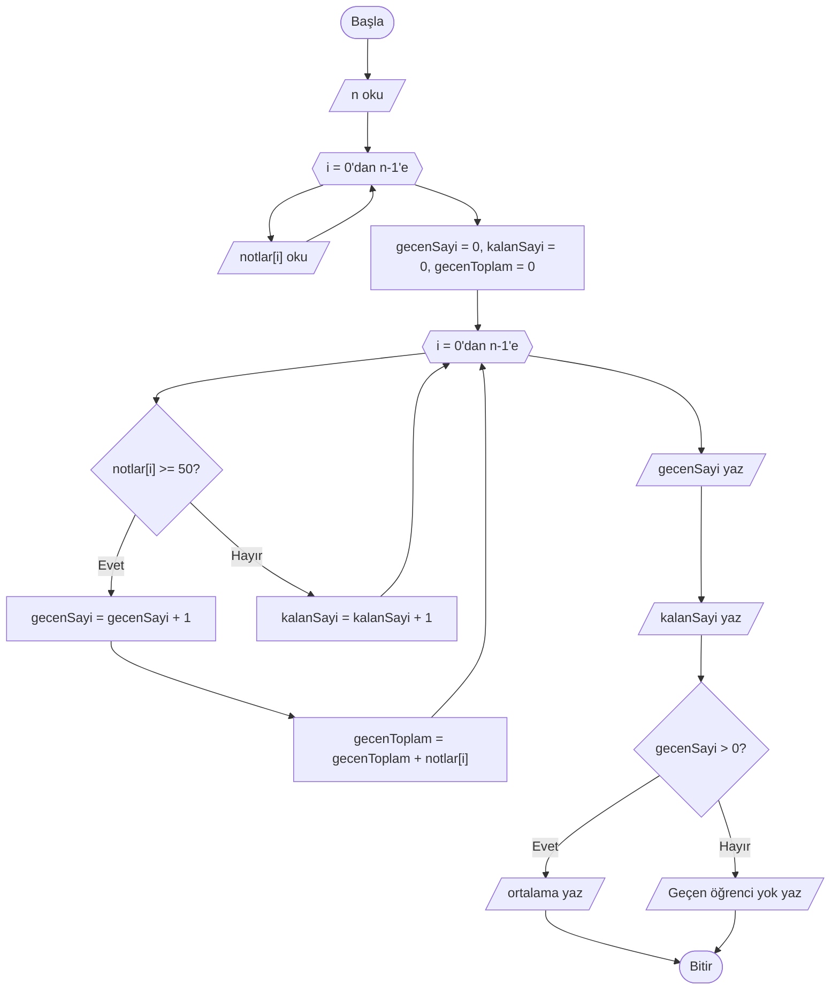
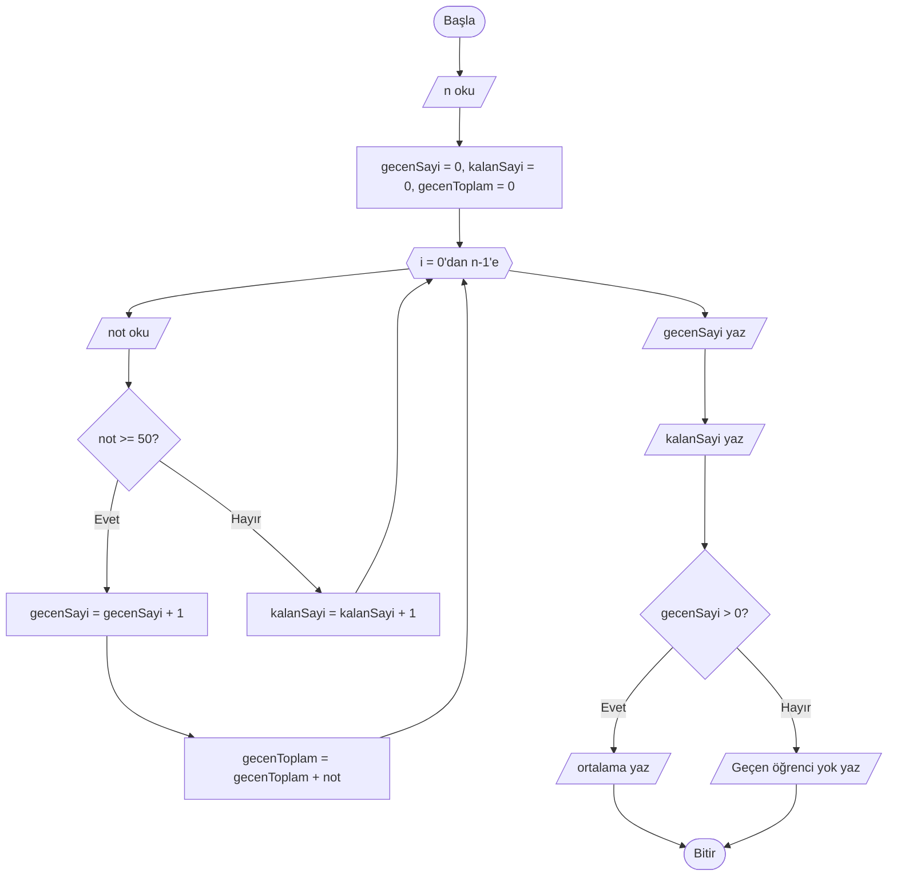

# Problem Çözme Atölyesi

## 🎯 Bu Bölümde Ne Öğreneceksin?

- Birden çok kavramı bir arada kullanan problemleri çözeceksin.
- Aynı probleme farklı çözüm yaklaşımları geliştireceksin.
- Çözümleri gereksiz adımlardan arındırmayı öğreneceksin.

## 💡 Neden Önemli?

Şimdiye kadar kavramları çoğunlukla tek tek öğrendin. Ama gerçek problemler hiçbir
zaman tek bir kavramla çözülmez. Bir problemi çözmek, elindeki araçları doğru
sırayla ve doğru yerde kullanmayı gerektirir.

Bu bölüm bir "atölye"dir: yeni bir kavram öğrenmek yerine, öğrendiklerini
birleştirmeyi ve daha iyi bir çözüme doğru sadeleştirmeyi çalışacağız. Aynı
problemin birden çok çözümü olabileceğini ve aralarından daha sade olanı
seçmeyi göreceksin.

## 🔗 Ön Bilgi

Bu bölüm, Bölüm 1'den 9'a kadar öğrendiğin her şeyi kullanır: algoritma kurma,
sözde kod, değişkenler, işlemler, kararlar, döngüler, diziler, izleme ve sınır
durumları, arama ve sıralama.

## ❓ Problem

Bir öğretmen, sınıftaki `n` öğrencinin notunu giriyor. Öğretmen üç şey öğrenmek
istiyor:

1. Kaç öğrenci geçti (notu 50 veya üzeri)?
2. Kaç öğrenci kaldı?
3. Geçen öğrencilerin not ortalaması kaçtır?

Bu problem, öğrendiğin pek çok aracı aynı anda gerektiriyor. Peki nereden
başlarsın?

## 🤔 Birlikte Düşünelim

Karmaşık bir problemi çözmenin ilk adımı, onu küçük parçalara ayırmaktır. Bu
problemin parçalarını sıralayalım:

- Girdi: `n` ve `n` tane not.
- Saklanacak şeyler: geçen öğrenci sayısı, kalan öğrenci sayısı, geçen
  öğrencilerin not toplamı. Bunlar birer birikim ya da sayaç değişkenidir.
- Gereken yapı: döngü (her notu işlemek için) ve karar (not geçti mi?).
- Çıktı: geçen sayısı, kalan sayısı, geçenlerin ortalaması.

Şimdi kendine sor: Notları önce bir dizide saklamak şart mı, yoksa okuduğumuz
anda işleyebilir miyiz? Cevabını yazmadan devam etme. Bu sorunun yanıtı, bu
bölümün ana fikrini oluşturuyor.

## 🧭 Çözüm Fikri

Bir problemi çözerken şu yolu izle:

1. **Anla:** Senden tam olarak ne isteniyor?
2. **Girdi ve çıktıyı belirle:** Başlangıçta ne var, sonunda ne olmalı?
3. **Hangi kavramlar gerekli?** Döngü mü, karar mı, dizi mi, birikim mi?
4. **Adımları kur:** Problemi sözde koda dök.
5. **Çalıştır ve sına:** Elle izle; sınır durumlarını dene.
6. **Sadeleştir:** Gereksiz adım var mı? Aynı sonucu daha basit bir yolla elde
   edebilir misin?

Çoğu zaman bir problemin birden çok çözümü vardır. Yalnızca doğru olanı değil,
**sade olanı** da aramak iyi bir alışkanlıktır. Daha az değişken, daha az döngü
ya da daha açık bir akış, çözümünü daha kolay anlaşılır ve daha kolay
düzeltilebilir kılar.

## 📝 Sözde Kod

**Yaklaşım 1: Notları dizide saklayarak.** Önce tüm notları bir dizide toplarız;
sonra diziyi gezip gerekli değerleri hesaplarız.

```pseudocode
BAŞLA
    OKU n
    notlar = DİZİ(n)

    DÖNGÜ i = 0'dan n-1'e ADIM 1
        OKU notlar[i]
    DÖNGÜ SONU

    gecenSayi = 0
    kalanSayi = 0
    gecenToplam = 0

    DÖNGÜ i = 0'dan n-1'e ADIM 1
        EĞER notlar[i] >= 50 İSE
            gecenSayi = gecenSayi + 1
            gecenToplam = gecenToplam + notlar[i]
        DEĞİLSE
            kalanSayi = kalanSayi + 1
        EĞER SONU
    DÖNGÜ SONU

    YAZ gecenSayi
    YAZ kalanSayi

    EĞER gecenSayi > 0 İSE
        YAZ gecenToplam / gecenSayi
    DEĞİLSE
        YAZ "Geçen öğrenci yok"
    EĞER SONU
BİTİR
```

**Yaklaşım 2: Notları saklamadan.** Notları sonradan kullanmamız gerekmediğine
göre, onları okuduğumuz anda işleyebiliriz. Böylece diziye hiç ihtiyaç kalmaz:

```pseudocode
BAŞLA
    OKU n

    gecenSayi = 0
    kalanSayi = 0
    gecenToplam = 0

    DÖNGÜ i = 0'dan n-1'e ADIM 1
        OKU not
        EĞER not >= 50 İSE
            gecenSayi = gecenSayi + 1
            gecenToplam = gecenToplam + not
        DEĞİLSE
            kalanSayi = kalanSayi + 1
        EĞER SONU
    DÖNGÜ SONU

    YAZ gecenSayi
    YAZ kalanSayi

    EĞER gecenSayi > 0 İSE
        YAZ gecenToplam / gecenSayi
    DEĞİLSE
        YAZ "Geçen öğrenci yok"
    EĞER SONU
BİTİR
```

İki yaklaşım da aynı sonucu verir. Ama ikincisi daha sadedir: bir döngü daha az,
bir dizi daha az. Bir değeri sonradan kullanmayacaksak, onu saklamanın anlamı
yoktur. "Saklamak gerçekten gerekli mi?" sorusu, çözümleri sadeleştirmenin en
güçlü aracıdır.

## 🗺️ Akış Şeması

**Yaklaşım 1 (dizili).** Önce notlar bir döngüyle diziye doldurulur; sonra ikinci
bir döngüde işlenir:



**Yaklaşım 2 (dizisiz).** Tek bir döngüde okuyup işler; diziye gerek yoktur:



İki şemayı yan yana karşılaştırdığında, ikinci şemanın daha az kutu ve daha az
döngü içerdiğini göreceksin.

## ⏱️ Elle Çalıştıralım

İkinci yaklaşımı beş notla (70, 40, 90, 30, 55) elle çalıştıralım.

| Tur | i | not | Koşul (>= 50) | gecenSayi | kalanSayi | gecenToplam |
|---|---|---|---|---|---|---|
| 1 | 0 | 70 | doğru | 1 | 0 | 70 |
| 2 | 1 | 40 | yanlış | 1 | 1 | 70 |
| 3 | 2 | 90 | doğru | 2 | 1 | 160 |
| 4 | 3 | 30 | yanlış | 2 | 2 | 160 |
| 5 | 4 | 55 | doğru | 3 | 2 | 215 |

Döngü bittikten sonra: geçen sayısı 3, kalan sayısı 2, geçenlerin ortalaması
`215 / 3` yani yaklaşık 71.67 olarak yazılır.

## ⚠️ Bir Şeyler Ters Giderse

**Belirti 1:** Öğretmenin ortalaması hiçbir zaman yazılmıyor ya da anlamsız bir
sonuç çıkıyor.

**Olası neden:** Sınıfta hiç geçen öğrenci yoksa (`gecenSayi` 0'a eşitse),
ortalama hesabı `gecenToplam / 0` yapılmaya çalışılır; bu tanımsızdır. Bu yüzden
algoritmaya `EĞER gecenSayi > 0 İSE` kararını ekledik.

**Belirti 2:** Sayılar birbirine karışıyor; örneğin geçen ve kalan sayısı aynı
çıkıyor.

**Olası neden:** Aynı değişkeni iki farklı amaç için kullanmak. Her sayacın ve
her birikim değişkeninin tek bir görevi olmalı. Örneğin geçenleri saymak için
ayrı, kalanları saymak için ayrı bir değişken kullan.

## ✍️ Kendin Dene

**1.** Bir dizideki en büyük ve en küçük değeri **tek bir döngüde** bul. İki ayrı
döngü kullanmak yerine, aynı döngüde iki değeri birden güncelle.

**2.** Bir dizideki sayılardan kaç tanesinin çift olduğunu bulan bir algoritma
yaz.

**3.** Az önceki birinci soruyu iki farklı yaklaşımla çöz: (a) tek döngüde iki
değeri birlikte bul, (b) iki ayrı döngüde birer birer bul. Hangisi daha sade?
Neden?

<details>
<summary>İpucu</summary>

1. Başlangıçta `enBuyuk` ve `enKucuk` değişkenlerinin ikisini de dizinin ilk
   elemanına (`sayilar[0]`) eşitle; sonra tek döngüde ikisini ayrı ayrı
   karşılaştır.
2. Bir sayaç kullan; `sayilar[i] mod 2 == 0` ise sayacı bir artır.
3. Her iki çözümün kaç döngü ve kaç değişken kullandığını say.

</details>

<details>
<summary>Çözümleri göster</summary>

1. Örnek çözüm:

```pseudocode
BAŞLA
    OKU n
    sayilar = DİZİ(n)
    DÖNGÜ i = 0'dan n-1'e ADIM 1
        OKU sayilar[i]
    DÖNGÜ SONU

    enBuyuk = sayilar[0]
    enKucuk = sayilar[0]
    DÖNGÜ i = 1'den n-1'e ADIM 1
        EĞER sayilar[i] > enBuyuk İSE
            enBuyuk = sayilar[i]
        EĞER SONU
        EĞER sayilar[i] < enKucuk İSE
            enKucuk = sayilar[i]
        EĞER SONU
    DÖNGÜ SONU

    YAZ enBuyuk
    YAZ enKucuk
BİTİR
```

2. Örnek çözüm:

```pseudocode
BAŞLA
    OKU n
    ciftSayi = 0
    DÖNGÜ i = 0'dan n-1'e ADIM 1
        OKU sayi
        EĞER sayi mod 2 == 0 İSE
            ciftSayi = ciftSayi + 1
        EĞER SONU
    DÖNGÜ SONU
    YAZ ciftSayi
BİTİR
```

3. İlk yaklaşım tek döngü kullandığı için daha sadedir; diziyi bir kez gezmek
yeterlidir. İkinci yaklaşım diziyi iki kez gezer ve iki döngü içerir; aynı
sonucu verir ama daha uzundur.

</details>

## 🎓 Öğrendiklerini Kontrol Et

**1.** Karmaşık bir problemi çözerken ilk adım ne olmalıdır?

**2.** Bir değeri sonradan kullanmayacaksan neden onu saklamak gereksizdir?

**3.** "Aynı değişkeni iki farklı amaç için kullanmak" neden tehlikelidir?

**4.** İki çözüm de doğruysa hangisini tercih etmelisin?

<details>
<summary>Cevapları göster</summary>

1. Problemi küçük parçalara ayırmak; ardından girdiyi, çıktıyı ve gereken
kavramları belirlemek.

2. Çünkü saklamanın tek amacı değeri sonradan kullanmaktır. Kullanmayacaksan
dizi ya da fazladan değişken yalnızca çözümü karmaşıklaştırır.

3. Çünkü değişkenin değeri iki farklı anlam taşımaya başlar; bu da sonuçların
karışmasına ve hatanın bulunmasının zorlaşmasına yol açar.

4. Daha sade olanı: daha az değişken, daha az döngü ve daha açık bir akış
kullananı.

</details>

## 🚀 Bağımsız Çalışma

Bir market rafındaki ürünlerin fiyatlarını işleyen bir algoritma tasarla.
Kullanıcı `n` ürün fiyatı girsin. Algoritma şunları üretsin: toplam ciro,
ortalama fiyat, en pahalı ürünün fiyatı ve fiyatı ortalamanın üzerinde olan
ürünlerin sayısı.

Önce problemi parçalara ayır, hangi kavramların gerektiğini yaz, sonra sözde kodu
kur ve akış şemasını çiz. Ardından küçük bir örnek (5 fiyat) ile elle çalıştır ve
sonuçları elle hesapladığın değerlerle karşılaştır. Son olarak sor: Bu problemde
fiyatları saklamak gerekli mi, yoksa okuduğun anda işleyebilir misin? İki sürümü
de yazıp hangisinin daha sade olduğunu gerekçelendir.

## 📖 Daha Fazlasını Öğrenmek

- Problemi parçalara ayırma (decomposition), bilgisayar bilimlerinin temel bir
  düşünme becerisidir. Bu beceriyi günlük hayattaki karmaşık işlere
  uygulayabilirsin.
- Çözdüğün problemleri bir defterde biriktir; her problem için "hangi kavramları
  kullandım, nasıl sadeleştirebilirim?" notlarını yaz. Bu, ilerledikçe en değerli
  kaynağın olacak.

## 📌 Kısa Özet

- Gerçek problemler tek bir kavramla değil, birçok kavramın birleşimiyle çözülür.
- Problemi çözmenin yolu: anla, girdi ve çıktıyı belirle, gereken kavramları
  seç, adımları kur, çalıştır ve sına, sadeleştir.
- Bir değeri sonradan kullanmayacaksan saklamak gerekmez; bu, çözümü sadeleştirir.
- Her değişkenin tek bir görevi olmalıdır.
- Aynı problemin birden çok doğru çözümü olabilir; daha sade olanı tercih et.
- Bir sonraki ve son bölümde, kursun tamamını bir bütün olarak gözden geçirecek
  ve öğrenmeyi nasıl sürdüreceğini planlayacaksın.

---
[Geri: Sıralama Algoritmaları](09-Sorting-Algorithms.md) | [İleri: Genel Tekrar ve Yolun Devamı](11-Review-And-Continuation.md)
