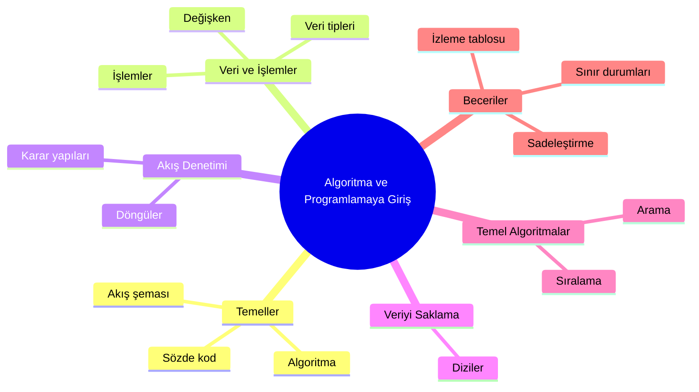
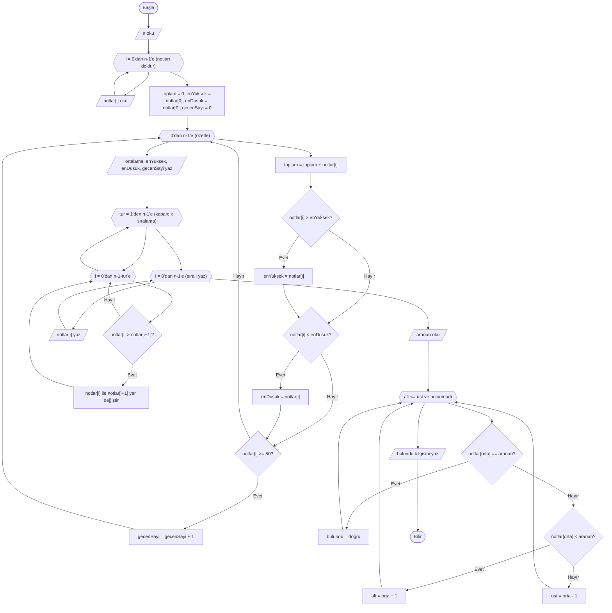

# Genel Tekrar ve Yolun Devamı

## 🎯 Bu Bölümde Ne Öğreneceksin?

- Kurs boyunca öğrendiklerini bir bütün olarak göreceksin.
- Baştan sona, tüm kavramları kullanan tek bir problem çözeceksin.
- Öğrenmeyi nasıl sürdüreceğini planlayacaksın.

## 💡 Neden Önemli?

Bu kursun amacı, bir sürü algoritmayı ezberletmek değildi. Amaç, bir problemi
gördüğünde onu anlayıp adımlara ayırabilmen, çözümünü sözde kod ve akış şemasıyla
ifade edebilmen ve çözümünü sınayabilmendi. Bu düşünme biçimi, hangi programlama
diline geçersen geç yanında taşıyacağın asıl kazanımdır.

Bu son bölümde, öğrendiğin her şeyi tek bir problemde birleştireceğiz ve birlikte
kısa bir yol haritası çizeceğiz: buradan sonra nasıl ilerlersin?

## 🔗 Ön Bilgi

Bu bölüm, Bölüm 1'den 10'a kadar öğrendiğin tüm kavramları kullanır. Yeni bir
kavram yok; yalnızca bir bütünleştirme ve kapanış var.

## ❓ Problem

Bir öğretmen, dönem sonu raporu hazırlamak istiyor. Elinde `n` öğrencinin notu
var. Bir algoritma şunları üretsin:

1. Notların ortalaması.
2. En yüksek ve en düşük not.
3. Geçen öğrenci sayısı (notu 50 veya üzeri).
4. Notların küçükten büyüğe sıralı hâli.
5. Verilen belirli bir notun listede olup olmadığı.

Bu problem; dizileri, döngüleri, kararları, birikim değişkenlerini, sıralamayı ve
aramayı aynı anda gerektiriyor. Yani bu bölüme kadar öğrendiğin neredeyse her
şeyi.

## 🤔 Birlikte Düşünelim

Büyük bir problemi çözmenin yolu, onu tanıdık parçalara bölmektir. Bu problemi
parçalayalım ve her parçayı hangi bölümde öğrendiğimizi hatırlayalım:

- Ortalama, en yüksek, en düşük ve geçen sayısı: tek bir döngüde, dört ayrı
  birikim/sayaç değişkeniyle bulunabilir (Bölüm 5, 6, 7).
- Sıralı hâl: Bölüm 9'da öğrendiğin kabarcık sıralama.
- Belirli bir notu arama: liste sıralı olduğu için Bölüm 8'deki ikili arama.
- Sıfıra bölme, boş veri gibi durumlar: Bölüm 7'deki sınır durumları.

Şimdi kendine sor: Bu parçaları hangi sırayla yapmalıyız? Örneğin aramayı
sıralamadan önce mi yapmalı, sonra mı? Cevabını yazmadan devam etme. Doğru cevap
şudur: ikili arama sıralı liste istediği için önce sıralama, sonra arama
yapılmalıdır. Parçaların sırası da en az parçaların kendisi kadar önemlidir.

## 🧭 Çözüm Fikri

Kurs boyunca öğrendiğin kavramlar birbirine şöyle bağlanır:



Bu harita, bir konunun diğerine nasıl dayandığını gösterir. Örneğin döngüler
karar yapılarına, diziler döngülere, ikili arama sıralamaya dayanır. Bir konuyu
anlamakta zorlanırsan, haritada onun bir altındaki kutuya dönmek çoğu zaman işe
yarar.

## 📝 Sözde Kod

Aşağıdaki çözüm, öğrendiklerimizi bir araya getiriyor. Uzun görünse de her parçası
tanıdık; sırayla oku.

```pseudocode
BAŞLA
    OKU n
    notlar = DİZİ(n)
    DÖNGÜ i = 0'dan n-1'e ADIM 1
        OKU notlar[i]
    DÖNGÜ SONU

    # 1) Ortalama, en yüksek, en düşük, geçen sayısı
    toplam = 0
    enYuksek = notlar[0]
    enDusuk = notlar[0]
    gecenSayi = 0
    DÖNGÜ i = 0'dan n-1'e ADIM 1
        toplam = toplam + notlar[i]
        EĞER notlar[i] > enYuksek İSE
            enYuksek = notlar[i]
        EĞER SONU
        EĞER notlar[i] < enDusuk İSE
            enDusuk = notlar[i]
        EĞER SONU
        EĞER notlar[i] >= 50 İSE
            gecenSayi = gecenSayi + 1
        EĞER SONU
    DÖNGÜ SONU
    ortalama = toplam / n

    YAZ ortalama
    YAZ enYuksek
    YAZ enDusuk
    YAZ gecenSayi

    # 2) Notları sırala (kabarcık sıralama)
    DÖNGÜ tur = 1'den n-1'e ADIM 1
        DÖNGÜ i = 0'dan n-1-tur'e ADIM 1
            EĞER notlar[i] > notlar[i+1] İSE
                gecici = notlar[i]
                notlar[i] = notlar[i+1]
                notlar[i+1] = gecici
            EĞER SONU
        DÖNGÜ SONU
    DÖNGÜ SONU

    DÖNGÜ i = 0'dan n-1'e ADIM 1
        YAZ notlar[i]
    DÖNGÜ SONU

    # 3) Belirli bir notu ara (ikili arama)
    OKU aranan
    alt = 0
    ust = n-1
    bulundu = yanlış
    DÖNGÜ (alt <= ust) VE (bulundu == yanlış) İKEN
        orta = (alt + ust) / 2
        EĞER notlar[orta] == aranan İSE
            bulundu = doğru
        DEĞİLSE EĞER notlar[orta] < aranan İSE
            alt = orta + 1
        DEĞİLSE
            ust = orta - 1
        EĞER SONU
    DÖNGÜ SONU

    EĞER bulundu İSE
        YAZ "Aranan not listede var"
    DEĞİLSE
        YAZ "Aranan not listede yok"
    EĞER SONU
BİTİR
```

## 🗺️ Akış Şeması

Aynı çözümün akış şeması aşağıdadır. Döngüler altıgenle, kararlar eşkenar
dörtgenle, giriş ve çıkış kutuları paralel kenarla gösterilmiştir.



Şema uzun görünüyor; çünkü kurs boyunca öğrendiğin üç ana algoritmayı (özetleme,
sıralama, arama) tek bir akışta birleştiriyor. Her parçayı ilgili bölümden
hatırlayabilirsin.

## ⏱️ Elle Çalıştıralım

Üç notla (`[60, 45, 90]`, `n = 3`) ilk kısmı izleyelim:

| Tur | i | notlar[i] | toplam | enYuksek | enDusuk | gecenSayi |
|---|---|---|---|---|---|---|
| Başlangıç | - | - | 0 | 60 | 60 | 0 |
| 1 | 0 | 60 | 60 | 60 | 60 | 1 |
| 2 | 1 | 45 | 105 | 60 | 45 | 1 |
| 3 | 2 | 90 | 195 | 90 | 45 | 2 |

Buradan: ortalama `195 / 3 = 65`; en yüksek 90; en düşük 45; geçen sayısı 2.

Sıralama bölümü diziyi `[45, 60, 90]` hâline getirir. Sonra 90 sayısını ikili
aramayla ararsak: `alt = 0`, `ust = 2`, `orta = 1` -> `notlar[1] = 60 < 90`, `alt = 2`;
sonra `alt = 2`, `ust = 2`, `orta = 2` -> `notlar[2] = 90`, bulundu. Sonuç:
"Aranan not listede var".

## ⚠️ Bir Şeyler Ters Giderse

Bütün bir problemi çözerken en sık yapılan hatalar şunlardır:

- **Parçaların sırasını karıştırmak:** İkili aramayı sıralamadan önce yapmak,
  yanlış sonuç verir. Parçaların birbirine bağımlılığını önce düşün.
- **Sınır durumlarını atlamak:** Boş liste, tek eleman, sıfıra bölme gibi
  durumları sınamadan çözümü tam sayma. Bölüm 7'nin yöntemini hatırla.
- **Gereksiz saklama:** Kullanmayacağın bir değeri dizide tutmak, çözümü
  gereksiz yere büyütür (Bölüm 10).
- **Değişkenleri karıştırmak:** Her değişkenin tek bir görevi olsun; aynı
  değişkeni iki amaçla kullanma.

## ✍️ Kendin Dene

**1.** Aşağıdaki kavramları, öğrendiğin bölümlerle eşleştir: döngü, ikili arama,
geçici değişkenle yer değiştirme, izleme tablosu.

**2.** Bir dizide hem en büyük hem de en büyük ikinci değeri bulan bir algoritma
taslağı kur.

**3.** Şu ifadenin sonucunu hesapla ve hangi bölümden yararlandığını söyle:
`(3 + 4) * 2 mod 5`

<details>
<summary>İpucu</summary>

1. Her kavramın ilk kez işlendiği bölümü hatırla.
2. En büyüğü bulurken, yeni bir en büyük adayı çıktığında eski en büyüğü
   "ikinci en büyük" olarak sakla.
3. İşlem sırası Bölüm 3'teki kurala göre işler.

</details>

<details>
<summary>Çözümleri göster</summary>

1. Döngü - Bölüm 5; ikili arama - Bölüm 8; geçici değişkenle yer değiştirme -
   Bölüm 9; izleme tablosu - Bölüm 7.

2. Örnek çözüm:

```pseudocode
BAŞLA
    OKU n
    sayilar = DİZİ(n)
    DÖNGÜ i = 0'dan n-1'e ADIM 1
        OKU sayilar[i]
    DÖNGÜ SONU

    birinci = sayilar[0]
    ikinci = sayilar[0]
    DÖNGÜ i = 1'den n-1'e ADIM 1
        EĞER sayilar[i] > birinci İSE
            ikinci = birinci
            birinci = sayilar[i]
        DEĞİLSE EĞER sayilar[i] > ikinci İSE
            ikinci = sayilar[i]
        EĞER SONU
    DÖNGÜ SONU

    YAZ birinci
    YAZ ikinci
BİTİR
```

3. `(3 + 4) * 2 mod 5` -> önce parantez: `7`; sonra `7 * 2 = 14`; sonra
   `14 mod 5` işleminin sonucu 4'tür. Sonuç 4'tür. İşlem sırası Bölüm 3'ten gelir.

</details>

## 🎓 Öğrendiklerini Kontrol Et

**1.** Bu kursta öğrendiğin, bir problemi çözmenin genel yolu nedir?

**2.** Bir problemi çözerken parçaların sırası neden önemlidir? Bir örnek ver.

**3.** İkili aramanın hangi ön koşulu vardır ve bu koşul hangi bölümle sağlanır?

**4.** Bir çözümü "sadeleştirmek" ne demektir?

<details>
<summary>Cevapları göster</summary>

1. Problemi anla; girdiyi ve çıktıyı belirle; gereken kavramları seç; adımları
sözde kod ve gerektiğinde akış şemasıyla kur; elle çalıştırıp sına; sonra
sadeleştir.

2. Çünkü bazı parçalar birbirine bağlıdır. Örneğin ikili arama sıralı liste
gerektirdiğinden, aramadan önce sıralama yapılmalıdır; sıra değişirse sonuç
yanlış olur.

3. İkili arama, dizinin sıralı olması koşuluyla çalışır. Bu koşulu sıralama
algoritmaları sağlar (Bölüm 9).

4. Sadeleştirmek; aynı sonucu daha az değişken, daha az döngü ve daha açık bir
akışla üretmek, gereksiz adımları kaldırmaktır.

</details>

## 🚀 Bağımsız Çalışma

Kendi hayatından, verilerle çözülebilecek bir problem seç. Örneğin bir harcama
listesi, bir kitap listesi, bir antrenman çizelgesi ya da bir oyunun puan
tablosu. Bu problem için:

1. Girdiyi ve çıktıyı belirle.
2. Gereken kavramları listele (döngü, karar, dizi, arama, sıralama...).
3. Sözde kodu yaz.
4. Gerekli yerlerde akış şeması çiz.
5. Küçük bir örnekle elle çalıştır.
6. Sınır durumlarını sına.
7. Çözümünü sadeleştirmek için bir tur daha düşün.

Bu yedi adımı tamamladıysan, artık bu kursun öğretmeyi amaçladığı düşünme
biçimini kendi başına uygulayabiliyorsun demektir.

**Öğrenmeyi sürdürmek için birkaç öneri:**

- Her gün küçük bir problem çöz; günde bir problem, haftada bir büyük çözümden
  daha etkilidir.
- Çözdüğün problemleri ve çözümlerini bir defterde biriktir; zaman zaman eski
  çözümlerine dön ve sadeleştir.
- Öğrendiğin bir kavramı birine anlat; anlatamadığın yer, tam olarak eksik olan
  yerindir.
- Yanlış yapmaktan çekinme; hatayı izleme tablosuyla bulmak, doğruyu ezberlemekten
  daha kalıcı öğretir.

## 📖 Daha Fazlasını Öğrenmek

Bu kurs, programlamaya girişin ve veri yapılarının ilk basamağıdır. Buradan
sonra öğrenebileceğin konular şunlardır:

- **Yığın (stack)** ve **kuyruk (queue):** Belirli kurallarla eleman ekleyip
  çıkardığın veri yapıları.
- **Bağlı liste (linked list):** Elemanların birbirine bağlarla bağlandığı bir
  dizi alternatifi.
- **Ağaç (tree)** ve **graf (graph):** Hiyerarşik ve birbirine bağlı verileri
  modelleyen yapılar.
- **Karmaşıklık analizi (Big-O):** Bir algoritmanın ne kadar hızlı olduğunu
  ölçmenin yolu.

Bu konulara geçmeden önce bu kurstaki temelleri sağlamlaştırman çok önemlidir;
çünkü hepsi burada öğrendiğin döngü, dizi, karar ve problem çözme mantığının
üzerine kurulur. Güvenilir kaynak olarak Türkçe Vikipedi maddeleri ve açık
öğretim kaynaklarından yararlanabilirsin.

## 📌 Kısa Özet

- Bu kursta öğrendiklerin: algoritma kurma, sözde kod ve akış şeması, değişken
  ve veri tipleri, işlemler, karar yapıları, döngüler, diziler, izleme ve sınır
  durumları, arama ve sıralama.
- Bu kavramlar birbirine dayanır; zorlandığında bir alt basamağa dönmek işe yarar.
- Bir problem; anlama, girdi-çıktı belirleme, kavram seçme, sözde kod kurma,
  sınama ve sadeleştirme adımlarıyla çözülür.
- Parçaların sırası ve sınır durumları, doğruluğun ayrılmaz parçasıdır.
- Asıl kazanım, belirli algoritmaları ezberlemek değil; problemi adımlara ayırma
  ve çözümü sınama düşünme biçimidir.
- Sıradaki durak: yığın, kuyruk, bağlı liste, ağaç, graf ve karmaşıklık analizi.
- Öğrenmenin en iyi yolu: çokça küçük problem çözmek, çözümleri biriktirmek ve
  öğrendiklerini başkalarına anlatmak.

---
[Geri: Problem Çözme Atölyesi](10-Problem-Solving-Workshop.md)
